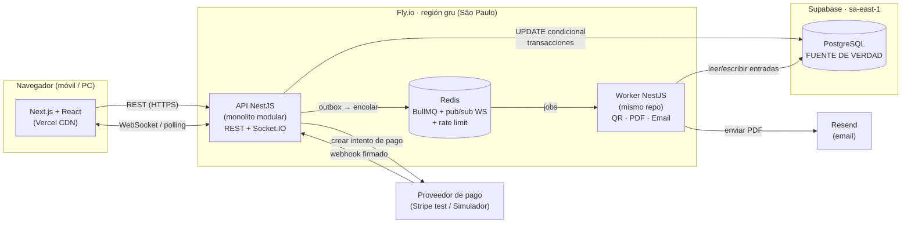

# 00 — Resumen

**Proyecto:** Sistema distribuido de venta de entradas con asientos numerados
**Materia:** Sistemas Distribuidos · **Duración:** 6 semanas · **Equipo:** 3 estudiantes
**Contexto:** Bolivia. Lanzamiento en Cochabamba y expansión nacional por fases.

## 1. El problema

Cuando se abre la venta de un concierto con 5.000 a 15.000 asientos, miles de personas intentan comprar a la vez, y muchas quieren **los mismos asientos**. Si dos personas pagan el mismo asiento se produce una **sobreventa**: una se queda sin lugar, hay que devolverle el dinero y la organización pierde reputación.

El problema central es de **concurrencia distribuida**: varias instancias de servidor, una cola, un proveedor de pagos externo que reintenta notificaciones y usuarios en redes móviles inestables. Aun así, el sistema debe garantizar:

> **Invariante principal:** un asiento de un evento tiene, como máximo, **una** entrada válida.

## 2. La solución en una frase

Un **monolito modular** en NestJS con un **proceso Worker** separado. **PostgreSQL** es la única fuente de verdad sobre quién gana cada asiento (actualización condicional atómica + restricciones únicas). **WebSocket** difunde el estado en vivo y una **cola** (BullMQ/Redis) genera el QR, el PDF y el email sin bloquear la venta.

## 3. Diagrama principal

## 4. Decisiones clave y justificación

| Decisión | Por qué |
|---|---|
| **Monolito modular, no microservicios** | Somos 3 personas y tenemos 6 semanas. Los microservicios añaden red, despliegues y consistencia eventual entre servicios sin resolver nuestro problema real, que es la concurrencia sobre una tabla. Los módulos tienen fronteras claras para poder separarlos más adelante si hiciera falta. |
| **PostgreSQL decide quién gana el asiento** | `UPDATE asientos SET estado='RESERVADO' ... WHERE id=$1 AND estado='LIBRE'` es atómico: si 50 peticiones llegan a la vez, solo una afecta 1 fila y las otras 49 afectan 0. No hace falta un lock distribuido. |
| **Redis no decide nada crítico** | Redis se usa para la cola, el pub/sub entre instancias y el rate limiting. Si Redis se pierde, no se pierde ninguna venta. |
| **Reserva de 5 min con `expires_at`** | La reserva vence sola: la consulta trata como libre un asiento cuyo `expires_at` ya pasó, aunque el job de limpieza no haya corrido todavía. |
| **Webhook idempotente + outbox** | El proveedor de pagos puede enviar el mismo aviso dos veces. Una restricción única sobre el ID del evento impide emitir dos entradas. El outbox garantiza que, si se confirmó el pago, el email **siempre** termina enviándose. |
| **Worker separado** | Si el Worker se cae, la API sigue vendiendo. Los trabajos quedan en la cola y en el outbox y se procesan cuando vuelve. |
| **Pagos detrás de un adaptador** | Stripe no opera con comercios bolivianos. Para la demo usamos Stripe en modo test y un simulador propio. En producción iría un QR bancario interoperable sin cambiar el núcleo. |

## 5. Qué conceptos de Sistemas Distribuidos se demuestran

- **Control de concurrencia** (actualización condicional, aislamiento READ COMMITTED, restricciones únicas)
- **Idempotencia** y semántica **al-menos-una-vez** con deduplicación
- **Outbox transaccional** (problema de la doble escritura)
- **Tolerancia a fallos** (caída del Worker, reintentos con backoff, cola de fallidos)
- **Escalado horizontal** de WebSocket con adaptador Redis (pub/sub)
- **Consistencia eventual** del mapa en el cliente (versionado + resincronización)
- **Rate limiting** y **control de admisión** ante picos

## 6. Demostración en vivo (≈10 min)

1. **Carrera por un asiento:** un script lanza 50 peticiones simultáneas por el asiento A-10. Resultado: **1 × 201** y **49 × 409**. Los logs y las métricas lo muestran.
2. **Mapa en vivo:** dos navegadores. Al reservar en uno, el asiento cambia de color en el otro en menos de 1 s.
3. **Webhook duplicado:** el simulador envía dos veces el mismo pago y se emite **una** entrada.
4. **Caída del Worker:** se detiene el Worker, se hacen 3 compras y la cola crece. Al reiniciarlo, llegan los 3 emails.
5. **Expiración:** una reserva sin pagar se libera a los 5 min y el mapa se actualiza solo.
6. **Puerta:** se escanea el QR. La primera vez sale "VÁLIDA" y la segunda "YA USADA a las 21:04".

## 7. Alcance y límites honestos

- **Dentro:** comprador, organizador y validador; mapa en tiempo real; reserva; pago test; QR + PDF + email; validación.
- **Fuera:** búsqueda compleja, OAuth, recuperación de contraseña, facturación electrónica del SIN (queda un campo NIT opcional) y cobro real en Bolivia.
- **Límite de la demo:** la infraestructura es de nivel gratis o casi gratis. **No** soporta de verdad 15.000 usuarios simultáneos. En `docs/06` mostramos el cálculo de qué haría falta y dónde estarían los cuellos de botella.

## 8. Plan

Seis sprints semanales en slices verticales. La semana 2 ya incluye la prueba de 50 peticiones concurrentes con TDD. Detalle en `11-plan-6-semanas.md`.
