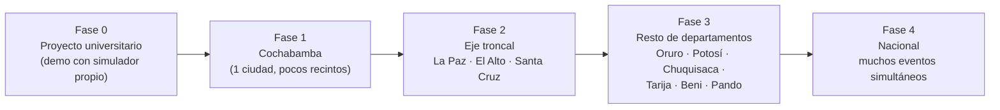

# 01 — Visión y alcance

## 1. Visión

> Que cualquier persona en Bolivia pueda comprar desde el celular una entrada con asiento numerado para un concierto, una obra o un partido, **sin miedo a que le vendan su asiento a otra persona**, aunque miles intenten comprar al mismo tiempo.

## 2. Problema que resolvemos

Hoy, en muchos eventos de Bolivia:
- la venta es presencial o por WhatsApp/transferencia, con verificación manual del comprobante;
- los asientos se asignan "a mano" en planillas, lo que provoca **duplicados** y discusiones en la puerta;
- las páginas que intentan vender en línea **se caen** cuando se abre la venta de un evento popular.

Nuestro sistema ataca tres causas técnicas:
1. **Sobreventa** por concurrencia mal controlada.
2. **Caídas** porque todo ocurre en el camino síncrono (generar PDF, enviar email...).
3. **Falsificación** de entradas (capturas de pantalla, QR copiados).

## 3. Usuarios y roles

| Rol | Qué necesita | Ejemplo |
|---|---|---|
| **Comprador** | Ver eventos de su ciudad, elegir asiento, pagar y recibir la entrada | María, en Quillacollo, compra 2 asientos para un concierto en el Estadio Félix Capriles desde su celular con datos móviles |
| **Organizador/Admin** | Crear eventos, configurar el mapa de asientos y precios por zona, y ver las ventas | Una productora de Cochabamba carga un evento con 3 zonas: Platea, Preferencia y General numerada |
| **Validador** | Escanear el QR en la puerta y marcarlo como USADO | Un portero con un celular Android y conexión inestable en el ingreso al recinto |

## 4. Contexto Bolivia

| Aspecto | Decisión de diseño |
|---|---|
| **Moneda** | Bolivianos (BOB) guardados como **enteros en centavos**. Bs 150,50 se guarda como `15050`. |
| **Hora** | Se guarda en UTC y se muestra en `America/La_Paz` (UTC-4, sin horario de verano). Un concierto el sábado a las 21:00 en Cochabamba se guarda como `domingo 01:00 UTC`. |
| **Idioma** | Español de Bolivia en la interfaz, los emails y el PDF ("Bs", formato `1.234,50`). |
| **Teléfono** | Opcional, con formato `+591 7XXXXXXX`. |
| **Conectividad** | Usuarios con 4G de calidad variable. Frontend liviano, WebSocket con reconexión automática y polling de respaldo. |
| **Pagos** | Stripe no acepta comercios bolivianos (ver `13-pagos-en-bolivia.md`). La demo usa un **simulador propio como proveedor principal** (Stripe test es opcional). En producción iría QR interoperable. |
| **Facturación SIN** | Fuera de alcance. La orden guarda `nit` y `razon_social` opcionales para integrarla después. |
| **Datos personales** | Mínimos (email, nombre y teléfono opcional). El QR no lleva datos personales y la contraseña se guarda con argon2id. |

## 5. Lanzamiento y expansión por fases

| Fase | Qué cambia en el negocio | Qué cambia en el sistema | ¿Rediseño? |
|---|---|---|---|
| 0 — Demo | Eventos de prueba | Todo en una región, infraestructura mínima | — |
| 1 — Cochabamba | Primeros organizadores reales | Pago real (QR bancario), dominio, monitoreo | No: se cambia el adaptador de pago |
| 2 — Eje troncal | Eventos simultáneos en 3 ciudades | Más instancias de la API, Postgres con más CPU, sala de espera virtual | No: el filtro por ciudad ya existe |
| 3 — Resto | Muchos recintos pequeños | Más datos de catálogo, quizá caché de listados | No |
| 4 — Nacional | Picos simultáneos | Réplicas de lectura y tal vez separar el módulo de Notificaciones o de Validación | Parcial: extraer módulos que ya tienen fronteras claras |

**Por qué no hace falta rediseñar:** desde el día 1 el modelo de datos es `departamento → ciudad → recinto → evento`, y toda consulta de catálogo filtra por ciudad. Agregar Tarija es **insertar filas**, no cambiar código.

## 6. Alcance

### Dentro
- Registro e inicio de sesión con email y contraseña (JWT), con roles.
- Listado de eventos **filtrado por ciudad**, más el detalle del evento.
- Mapa de asientos **en tiempo real**.
- Reserva temporal de **5 minutos** (máx. 6 asientos por orden).
- Pago con el simulador; Stripe test opcional. Confirmado **por webhook**.
- Entrada con **QR firmado**, PDF y **email asíncrono**.
- Panel del organizador: crear evento, recinto y mapa (filas × columnas por zona) y precios.
- App web del validador: escanear QR y marcar USADA.
- Métricas y logs para la demo.

### Fuera (a propósito)
- Búsqueda de texto compleja, recomendaciones.
- OAuth (Google/Facebook) y recuperación de contraseña.
- Facturación electrónica del SIN (queda como mejora futura con campo NIT).
- Cobro real en Bolivia (queda documentado como adaptador futuro).
- Reventa, transferencia de entradas, reembolsos automáticos (los reembolsos se marcan para gestión manual).
- App nativa. El validador usa la web del celular.

## 7. Criterios de éxito del proyecto

1. Con 50 peticiones simultáneas por el mismo asiento, **siempre** gana exactamente una (probado en CI y en vivo).
2. Un webhook duplicado **nunca** produce dos entradas.
3. Con el Worker caído la venta sigue funcionando, y al volver se envían todos los emails pendientes.
4. El mapa se actualiza en otro navegador en **< 1 s (p95)** en condiciones normales.
5. El docente entiende la arquitectura con el `00-resumen-docente.md` y un diagrama.
