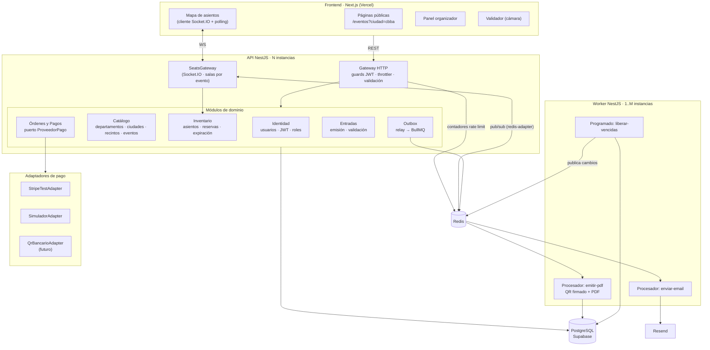
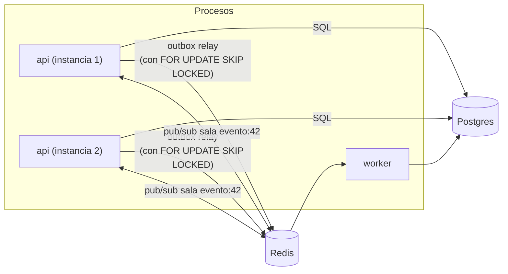

# 03 — Arquitectura

## 1. Estilo arquitectónico

**Monolito modular + Worker asíncrono**, con comunicación híbrida (REST + WebSocket + cola).

- **Monolito modular:** un solo despliegue de la API (que puede tener *N* instancias idénticas), organizado en **módulos con fronteras explícitas**. Cada módulo es dueño de sus tablas y expone un servicio público. Los demás módulos no tocan sus tablas directamente.
- **Worker:** **otro proceso** compilado desde el mismo repositorio que consume la cola. Comparte código (entidades, adaptadores) pero **no** comparte el ciclo de vida: si se cae, la API no se entera.

### ¿Por qué esto y no otra cosa?

**Problema:** necesitamos un sistema que soporte picos de concurrencia, que sea tolerante a fallos en las tareas lentas y que 3 estudiantes puedan construir en 6 semanas.

**Opciones:**
1. Monolito "clásico" (todo en un proceso, sin módulos).
2. Monolito modular + Worker.
3. Microservicios (Catálogo, Reservas, Pagos, Entradas y Notificaciones separados).
4. Serverless (funciones sueltas en Vercel/Lambda).

**Elección:** opción 2.

**Por qué:**
- Frente a la 1: separar el Worker es lo que nos da **tolerancia a fallos real**. Generar un PDF o llamar a la API de email puede tardar segundos o fallar, y no debe ocurrir dentro de la petición del comprador. Los módulos evitan el "código espagueti" y nos permiten trabajar en paralelo.
- Frente a la 3: ver la sección 5.
- Frente a la 4: las funciones serverless **no mantienen conexiones WebSocket** de larga duración, abren una conexión a Postgres por invocación (lo que agota las conexiones en un pico) y complican los jobs en segundo plano.

## 2. Diagrama de componentes

## 3. Justificación de cada componente

| Componente | Problema que resuelve | ¿Qué pasa si no está? | Alternativa descartada y por qué |
|---|---|---|---|
| **Next.js (Vercel)** | Páginas de catálogo rápidas en el celular (SSR/estático en CDN) y app React para el mapa | Una SPA pura tendría una carga inicial más pesada en 4G | SPA con Vite: válida, pero sin SSR el listado por ciudad tarda más en mostrarse en móviles lentos |
| **NestJS** | Estructura modular (módulos, DI, guards), WebSocket y BullMQ integrados, TypeScript en todo el stack | Con Express pelado, cada uno organizaría el código a su manera | Spring/Go: el equipo comparte TS con el frontend |
| **PostgreSQL** | **Fuente de verdad** con transacciones ACID, restricciones únicas y actualizaciones condicionales atómicas | Sin ACID no hay garantía de "un asiento, una entrada" | MongoDB: tiene operaciones atómicas por documento, pero las restricciones relacionales (FK, UNIQUE parciales) y las transacciones multitabla son más naturales en SQL |
| **Supabase** (solo Postgres) | Postgres administrado con backups, pooler y región São Paulo | Habría que operar Postgres nosotros | Supabase Auth/Realtime: **no se usan**. La auth y el tiempo real son parte de lo que queremos demostrar |
| **Redis** | 1) Transporte de la cola BullMQ · 2) pub/sub para el WebSocket con varias instancias · 3) contadores del rate limiting | Sin cola ni tolerancia a fallos, el WS solo funcionaría con 1 instancia | Usar Redis como lock de asientos: **descartado** (ver doc 04) |
| **BullMQ** | Cola con reintentos, backoff, cola de fallidos, jobs programados y deduplicación por `jobId` | Tendríamos que implementar reintentos a mano | RabbitMQ/Kafka: más potentes, pero un servicio más que operar **sin beneficio** a esta escala. Kafka **no aporta valor real** aquí |
| **Socket.IO** | Reconexión automática con backoff, salas, adaptador Redis y mensajes de confirmación (ack) | Con WS nativo habría que programar la reconexión y las salas a mano | SSE: válido para un solo sentido, pero el escalado multi-instancia es igual de complejo y Socket.IO trae más hecho |
| **Worker separado** | Aísla las tareas lentas o frágiles (PDF y email) | Una API de email lenta haría lento el checkout | Hacerlo en la misma API con `setImmediate`: si el proceso se reinicia, el trabajo **se pierde** |
| **Outbox (tabla)** | Garantiza que "pago confirmado" ⇒ "job encolado" aunque Redis falle en ese instante | Doble escritura: se confirma el pago en la BD, Redis falla y el email nunca sale | Encolar dentro de la transacción: imposible, Redis no participa en la transacción de Postgres |
| **Resend** | API de email simple, plan gratis de 3.000/mes (100/día), adjuntos | — | SendGrid: **retiró su plan gratis** en 2025 (ahora es una prueba de 60 días) |
| **Docker (local)** | El mismo Postgres y Redis para los 3 integrantes y para CI | "En mi máquina funciona" | Instalar Postgres a mano: versiones distintas |
| **GitHub Actions** | Los tests de concurrencia corren en cada PR contra un Postgres real | Una regresión de concurrencia llegaría a la demo | — |
| **Prisma** | Migraciones versionadas y tipos generados | — | TypeORM: también válido. Prisma es más sencillo de aprender. Las consultas críticas se escriben en **SQL explícito** con `$queryRaw` para que se vea qué hace la BD |

### Lo que **no** usamos y por qué (honestidad técnica)

| Tecnología | ¿Por qué no? |
|---|---|
| Microservicios | Ver sección 5 |
| Kubernetes | Fly.io ya da réplicas y despliegue. K8s sería semanas de configuración sin mejorar la nota de concurrencia |
| Kafka | Pensado para millones de eventos/s y retención larga. Nosotros tenemos decenas de jobs/s |
| GraphQL | Ver doc 05: nuestras consultas son pocas y fijas, y el tiempo real no encaja bien con suscripciones GraphQL a esta escala |
| Redlock / locks en Redis | Ver doc 04 |
| Service mesh, API gateway externo | Un solo servicio HTTP: no hay "malla" que gestionar |
| CQRS/Event Sourcing completo | Añade complejidad sin necesidad. Sí usamos una **idea** de CQRS: el mapa en vivo es una "vista de lectura" que se alimenta de eventos |

## 4. Módulos y sus fronteras

| Módulo | Tablas de las que es dueño | Expone | Depende de |
|---|---|---|---|
| Identidad | `usuarios` | `registrar`, `login`, guard JWT | — |
| Catálogo | `departamentos`, `ciudades`, `recintos`, `eventos`, `zonas` | `listarPorCiudad`, `publicar` | Identidad |
| Inventario | `asientos` | `reservar`, `liberar`, `marcarVendidos`, `snapshotMapa` | Catálogo |
| Órdenes y Pagos | `ordenes`, `orden_items`, `pagos`, `webhook_eventos` | `crearOrden`, `iniciarPago`, `procesarWebhook` | Inventario, Entradas |
| Entradas | `entradas`, `validaciones` | `emitir`, `validar` | — |
| Outbox | `outbox` | `registrar(evento)` (dentro de la transacción del llamador) | — |

**Regla:** si `Pagos` necesita marcar asientos como vendidos, llama a `InventarioService.marcarVendidos(tx, ordenId)` **pasando la transacción**. No hace un `UPDATE asientos` por su cuenta. Así, si algún día Inventario se separa, el punto de corte ya está definido.

## 5. Monolito modular vs. microservicios

### ¿Por qué NO microservicios en este proyecto?

1. **Nuestro problema difícil es transaccional, no organizacional.** Para "reservar asiento + crear orden" necesitamos **una transacción ACID**. Con Inventario y Órdenes en servicios distintos, cada uno con su base de datos, haría falta una **saga** con compensaciones: reservar en el servicio A, crear la orden en el B y, si B falla, liberar en A... Eso multiplica los casos de fallo que tenemos que probar.
2. **3 personas, 6 semanas.** Los microservicios rinden cuando hay **equipos independientes** que despliegan a ritmos distintos. Nosotros somos un solo equipo.
3. **Costo operativo.** Cada servicio pide su despliegue, su configuración, su monitoreo y su CI. En el free tier, eso significa más máquinas y más dinero.
4. **Latencia.** Cada salto de red añade milisegundos y un punto de fallo. En el camino de la reserva queremos **cero saltos** entre módulos.
5. **Escalado.** El monolito **sí escala horizontalmente**: corremos N copias idénticas detrás del balanceador. El cuello de botella es Postgres, y los microservicios no lo eliminan.

### ¿Cuándo SÍ tendrían sentido?

| Señal | Ejemplo en nuestra expansión nacional | Qué separaríamos |
|---|---|---|
| Un módulo tiene una **carga muy distinta** | En la Fase 4, la validación en puerta tiene picos en 50 recintos a las 20:00, mientras que la venta tiene picos al abrirse cada evento | **Validación** como servicio con su propia caché de entradas |
| Un módulo tiene **dependencias externas lentas o reguladas** | Integración con el SIN para facturar y con varios bancos para el QR | **Facturación** y **Pagos** como servicios con sus propios reintentos y credenciales aisladas |
| **Equipos distintos** | 3 equipos: catálogo/marketing, venta y operaciones en puerta | Un servicio por equipo |
| **Requisitos de seguridad distintos** | Cumplimiento con bancos (PCI, auditoría) | Pagos aislado en una red separada |
| **Tecnología distinta** | Generación masiva de PDF o imágenes | Servicio de renderizado |

**Conclusión:** empezamos con un monolito modular **diseñado para poder partirse** (módulos dueños de sus tablas, comunicación por servicios y eventos de outbox). Separar un módulo después es una decisión **reversible y gradual**: patrón *Strangler Fig* (ver doc 08).

## 6. Vista de procesos en ejecución

- **API:** atiende HTTP y WebSocket. Corre el **relay del outbox** cada ~500 ms. Varias instancias pueden correrlo a la vez gracias a `FOR UPDATE SKIP LOCKED`.
- **Worker:** procesa `emitir-pdf` y `enviar-email`, y cada 15 s el job repetible `liberar-vencidas`.
- **Por qué el relay está en la API y no en el Worker:** así, con el Worker caído, los jobs **se acumulan visiblemente en Redis** (se ve en la demo con Bull Board). Si además cae Redis, se acumulan en la tabla `outbox`. En ningún caso se pierden.
