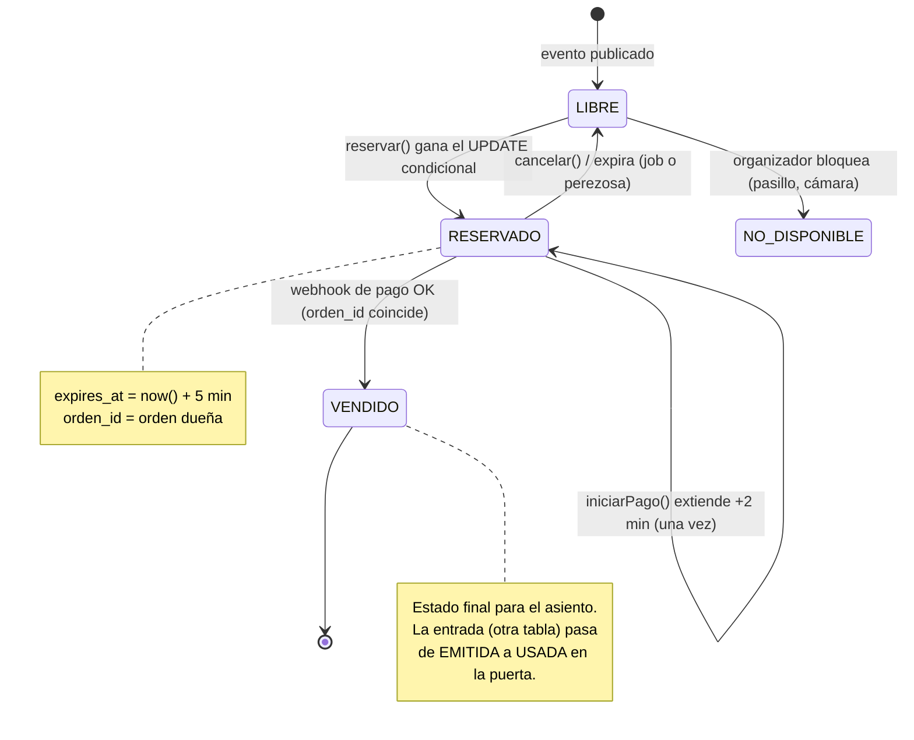
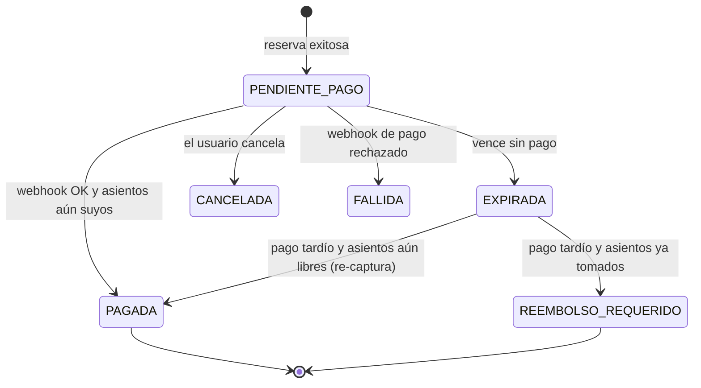
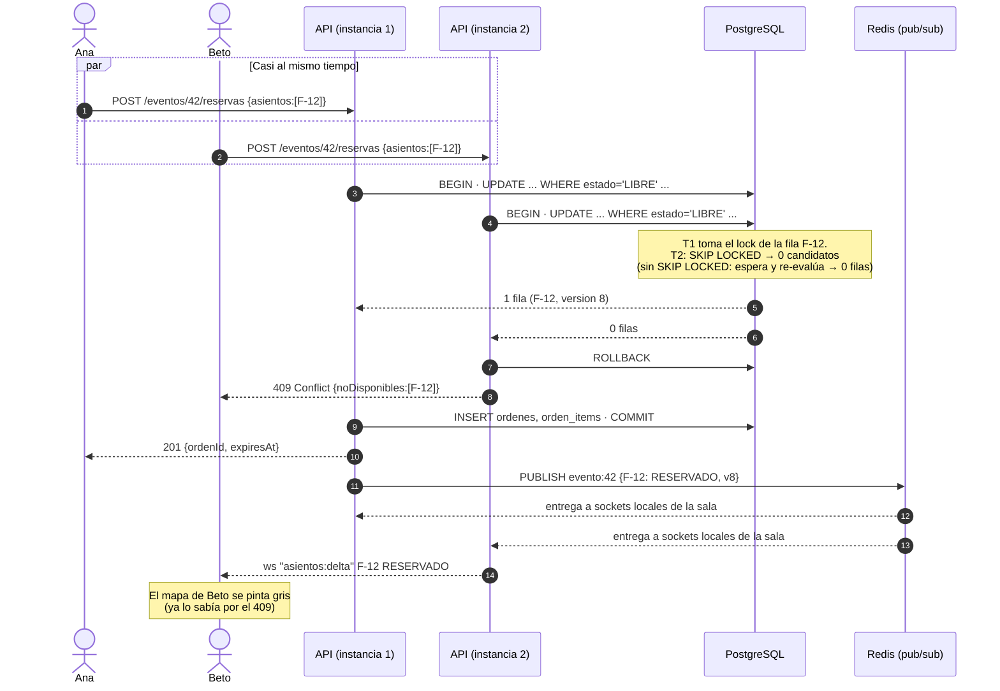
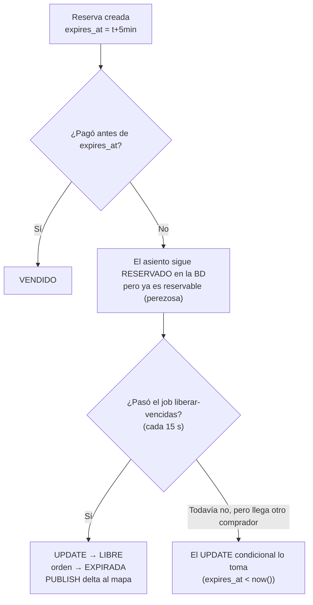

# 04 — Concurrencia y prevención de la doble compra

> **Invariante RN-01:** un asiento de un evento tiene **como máximo una** entrada válida.
> Todo este documento explica cómo lo garantizamos aunque haya miles de peticiones a la vez, varias instancias de la API, reintentos de red y webhooks duplicados.

## 1. Estados del asiento



Y los estados de la **orden**:



## 2. El problema, con un ejemplo

Ana (Cochabamba) y Beto (Sacaba) tocan el asiento **Platea F-12** en el mismo milisegundo. Las dos peticiones llegan a **instancias distintas** de la API.

Código ingenuo (**INCORRECTO**):

```text
1. SELECT estado FROM asientos WHERE id = 'F-12'   → 'LIBRE'  (Ana)
2. SELECT estado FROM asientos WHERE id = 'F-12'   → 'LIBRE'  (Beto)
3. UPDATE asientos SET estado='RESERVADO', orden=Ana
4. UPDATE asientos SET estado='RESERVADO', orden=Beto   ← pisa a Ana
```

Es una **condición de carrera** del tipo *check-then-act* (leer, decidir, escribir). Entre la lectura y la escritura, el mundo cambió.

## 3. Opciones para resolverlo

| Opción | Cómo funciona | Pros | Contras | ¿Elegida? |
|---|---|---|---|---|
| **A. UPDATE condicional atómico** ("bloqueo optimista" o *compare-and-set*) | `UPDATE ... WHERE estado='LIBRE'`: la condición y la escritura son **una sola operación** | Simple. Sin locks largos. El perdedor se entera de inmediato (0 filas) | Hay que manejar el "0 filas" | ✅ **Sí** |
| B. Bloqueo pesimista | `SELECT ... FOR UPDATE` y mantener la transacción abierta mientras el usuario decide o paga | Intuitivo | Las transacciones abiertas durante minutos agotan las conexiones. Los usuarios esperan en fila al de adelante. Riesgo de deadlocks | ❌ |
| C. Versión optimista clásica | Leer `version`, luego `UPDATE ... WHERE version = v` | Estándar en ORMs | Igual que A pero con un paso extra. Para un estado simple, A es más directo. (Igual guardamos `version` para el WebSocket) | Parcial |
| D. Lock distribuido en Redis (Redlock) | `SET lock:F-12 NX PX 5000` antes de tocar la BD | Rápido | **Dos fuentes de verdad.** Si el lock expira por una pausa (GC, red) dos procesos creen tenerlo. Si Redis pierde datos, se pierden locks. Igual hace falta la BD | ❌ |
| E. Cola única por evento (serializar) | Todas las reservas de un evento pasan por un solo consumidor | Imposible que haya carrera | Latencia alta, punto único de fallo, y el usuario no recibe la respuesta de inmediato | ❌ |
| F. Restricción única como única defensa | INSERT en `reservas(asiento_id)` UNIQUE y capturar el error | Muy robusto | Funciona, pero la expiración (borrar o reusar filas) se complica | Como **segunda red** |

### ¿Por qué no bloqueo pesimista? (B)

Problema: el comprador tarda de 30 s a 5 min en pagar. Si mantenemos `FOR UPDATE` durante ese tiempo:
- cada comprador ocupa **una conexión de Postgres**. El pooler gratuito de Supabase tiene decenas, no miles;
- el segundo usuario que toca F-12 **queda colgado esperando** en vez de recibir "ocupado" al instante;
- si el servidor se reinicia, Postgres libera el lock... pero el usuario pierde su reserva sin explicación.

El estado `RESERVADO` + `expires_at` es un **"lock lógico" persistido**: dura minutos, sobrevive a reinicios y **no ocupa conexiones**.

> Matiz técnico importante: el UPDATE condicional **sí** toma un lock de fila durante los milisegundos que dura su transacción. Lo que evitamos es mantener locks **mientras el usuario piensa**.

### ¿Por qué no lock distribuido en Redis? (D)

1. **Dos fuentes de verdad:** Redis dice "Ana tiene el lock" y Postgres dice "LIBRE". ¿A quién le creemos si discrepan?
2. **Los locks con TTL no son seguros ante pausas.** El proceso 1 toma el lock (TTL 5 s), sufre una pausa de 6 s (GC, red móvil, VM congelada), el lock expira, el proceso 2 lo toma y **ambos escriben**. Para evitarlo hacen falta *fencing tokens*, que tiene que verificar... la base de datos. Así que terminamos en la opción A igual.
3. **Redis no es durable por defecto.** Con un reinicio se pierden los locks.
4. **No aporta valor:** Postgres ya serializa los UPDATE sobre la misma fila. Añadir Redis solo agrega latencia y fallos posibles.

## 4. La solución elegida, paso a paso

### 4.1 Reservar (una sola sentencia, todo o nada)

```sql
-- Dentro de una transacción (READ COMMITTED, el nivel por defecto de Postgres)
WITH candidatos AS (
  SELECT id
  FROM asientos
  WHERE evento_id = $evento
    AND id = ANY($ids)                       -- máx. 6 asientos
    AND (
          estado = 'LIBRE'
       OR (estado = 'RESERVADO' AND expires_at < now())   -- expiración perezosa
    )
  ORDER BY id                                -- orden fijo ⇒ sin deadlocks
  FOR UPDATE SKIP LOCKED                     -- si otro lo está tocando, no esperar
)
UPDATE asientos a
SET estado     = 'RESERVADO',
    orden_id   = $orden,
    expires_at = now() + interval '5 minutes',
    version    = a.version + 1
FROM candidatos c
WHERE a.id = c.id
RETURNING a.id, a.version;
```

- Si `RETURNING` devuelve **tantas filas como asientos pedidos**: se crea la orden y sus ítems en la **misma transacción**, `COMMIT` y **201**.
- Si devuelve menos: **ROLLBACK** y **409 Conflict** con la lista de asientos no disponibles. Así se cumple el *todo o nada* (RN-03).

**Por qué cada parte:**
| Fragmento | Para qué |
|---|---|
| `estado='LIBRE' OR (... expires_at < now())` | **Expiración perezosa:** una reserva vencida se trata como libre **aunque el job aún no haya pasado**. La correctitud no depende del job |
| `ORDER BY id ... FOR UPDATE` | Dos órdenes que piden {F-12, F-13} y {F-13, F-12} toman los locks en el **mismo orden**, así que no puede haber *deadlock* |
| `SKIP LOCKED` | Si otra transacción está reservando F-12 en ese instante, no esperamos: F-12 queda fuera de los candidatos y respondemos 409 al instante |
| `version + 1` | El WebSocket envía la versión. El cliente descarta mensajes viejos que lleguen desordenados |

#### Versión mínima (un solo asiento), para entender la idea

```sql
UPDATE asientos
SET estado='RESERVADO', orden_id=$orden, expires_at=now()+interval '5 minutes'
WHERE id=$asiento AND (estado='LIBRE' OR (estado='RESERVADO' AND expires_at<now()))
RETURNING id;
```

¿Qué pasa con 2 transacciones simultáneas en READ COMMITTED?
1. T1 encuentra la fila LIBRE, la bloquea y la actualiza (todavía sin commit).
2. T2 encuentra la misma fila y **espera** el lock de T1 (milisegundos).
3. T1 hace COMMIT.
4. Postgres **re-evalúa el WHERE de T2** sobre la versión nueva de la fila: `estado='RESERVADO'` y `expires_at` está en el futuro, así que la condición es falsa y T2 actualiza **0 filas**.

Esta re-evaluación es la clave: el `WHERE` y el `SET` se comportan como **una sola operación atómica** sobre esa fila.

### 4.2 Segunda red de seguridad: restricciones en la BD

Aunque el código tuviera un bug, la base de datos impide el estado inválido:

```sql
-- Un asiento existe una vez por evento
UNIQUE (evento_id, fila, columna)

-- Una sola entrada válida por asiento (índice único parcial)
CREATE UNIQUE INDEX ux_entrada_valida_por_asiento
  ON entradas (asiento_id) WHERE estado IN ('EMITIDA','USADA');

-- Coherencia entre estado, orden y vencimiento
CHECK (
     (estado = 'RESERVADO'                 AND orden_id IS NOT NULL AND expires_at IS NOT NULL)
  OR (estado = 'VENDIDO'                   AND orden_id IS NOT NULL AND expires_at IS NULL)
  OR (estado IN ('LIBRE','NO_DISPONIBLE')  AND orden_id IS NULL     AND expires_at IS NULL)
)
```

> Nota sobre `SKIP LOCKED`: si la transacción que tenía bloqueada la fila termina en ROLLBACK, el segundo usuario recibió un 409 que en teoría no correspondía. Lo aceptamos: es raro, dura milisegundos y el usuario ve el asiento libre de nuevo en el mapa. A cambio, nadie se queda esperando un lock.

Así, la invariante RN-01 queda garantizada **por la base de datos**, no solo por nuestro código. Esto es *defensa en profundidad*.

### 4.3 Confirmar el pago (webhook)

```sql
-- Dentro de la transacción del webhook (ver doc 05 para la idempotencia)
UPDATE asientos
SET estado='VENDIDO', expires_at=NULL, version=version+1
WHERE orden_id = $orden AND estado = 'RESERVADO'
RETURNING id;
```
- Si se marcaron **todos** los asientos de la orden: orden PAGADA, `INSERT entradas` y `INSERT outbox` → COMMIT.
- **No** se exige `expires_at > now()` en este paso: si el pago llegó y nadie más tomó el asiento (sigue con nuestro `orden_id`), vendemos. Es la decisión más justa para el comprador.
- Si algún asiento ya tiene otro `orden_id` (venció y lo tomó otra persona): orden **REEMBOLSO_REQUERIDO**, se liberan los asientos que sí eran nuestros, outbox `REEMBOLSO_REQUERIDO` (email de disculpa). **Nunca** se emite una entrada duplicada.

## 5. Diagrama de secuencia: dos usuarios, un asiento



> Importante: **primero COMMIT, después PUBLISH.** Si publicáramos antes del commit y la transacción fallara, los clientes verían un estado que nunca existió. Si el PUBLISH falla después del commit, no pasa nada grave: el cliente se resincroniza (ver doc 05, §3).

## 6. Expiración de la reserva



Job `liberar-vencidas` (en el Worker, repetible cada 15 s):

```sql
WITH vencidos AS (
  SELECT id FROM asientos
  WHERE estado='RESERVADO' AND expires_at < now()
  ORDER BY id
  LIMIT 500
  FOR UPDATE SKIP LOCKED
)
UPDATE asientos a SET estado='LIBRE', orden_id=NULL, expires_at=NULL, version=a.version+1
FROM vencidos v WHERE a.id=v.id
RETURNING a.id, a.evento_id, a.version;
-- luego: UPDATE ordenes SET estado='EXPIRADA' WHERE estado='PENDIENTE_PAGO' AND expires_at < now()
-- luego: PUBLISH deltas por evento
```

- **`SKIP LOCKED` + `LIMIT`**: si hay 2 Workers no procesan la misma fila, y un lote grande no bloquea la tabla.
- **Si el Worker está caído:** los asientos vencidos se ven como RESERVADO en el mapa (dato visual algo desactualizado), pero **se pueden reservar** igual, gracias a la expiración perezosa. Además, el endpoint del mapa calcula `estado_efectivo` con la misma regla, así que **incluso el mapa se ve bien**:
  ```sql
  CASE WHEN estado='RESERVADO' AND expires_at < now() THEN 'LIBRE' ELSE estado END
  ```
- **Relojes:** todas las comparaciones usan `now()` **de Postgres**, nunca la hora del servidor de la API. Así se evitan errores por relojes desincronizados entre máquinas (*clock skew*). El contador del navegador es solo visual y se calcula a partir del `expiresAt` que envía el servidor.

## 7. ¿Qué pasa si falla cada paso?

| # | Falla | Qué ve el usuario | Estado del sistema | Por qué es seguro |
|---|---|---|---|---|
| 1 | La petición de reserva se pierde en la red móvil **antes** de llegar | Spinner, luego error. Reintenta | Nada cambió | — |
| 2 | La reserva se hizo, pero la **respuesta** se perdió | Error. Al reintentar recibe 409... ¡por su propio asiento! | Orden PENDIENTE_PAGO del mismo usuario | La petición lleva `Idempotency-Key` (UUID generado por el cliente). Un reintento con la misma clave **devuelve la orden existente** (201) en vez de 409. Además RN-04 (una orden pendiente por evento) permite mostrarle "Ya tienes una reserva" |
| 3 | La API se cae **durante** la transacción de reserva | Error | Postgres hace ROLLBACK automático | Atomicidad |
| 4 | La API se cae **después** del COMMIT y antes de PUBLISH | Su reserva existe y los demás no la ven en vivo | El mapa de los demás queda desactualizado hasta el próximo delta o resync | Si otro intenta reservar ese asiento, recibe 409. La BD decide, no el mapa |
| 5 | Redis cae | La reserva funciona. El mapa en vivo se congela y los clientes pasan a polling REST | Rate limiting en modo degradado (memoria local) | Redis no participa en la decisión |
| 6 | El usuario cierra la pestaña sin pagar | — | La reserva vence a los 5 min | Expiración perezosa + job |
| 7 | El usuario paga pero el **webhook** tarda 10 min | "Procesando pago..." | Puede vencer la reserva | Si el asiento sigue con su `orden_id` se vende. Si lo tomó otra persona: REEMBOLSO_REQUERIDO |
| 8 | Llega el **webhook duplicado** | — | — | `UNIQUE(proveedor, evento_externo_id)` (doc 05) |
| 9 | El Worker cae al emitir el PDF | La entrada aparece en "Mis entradas". El email llega más tarde | Job en Redis (o fila en outbox) | Reintento al volver |
| 10 | El reloj de una instancia de la API está adelantado 2 min | Nada | Nada | Solo usamos `now()` de Postgres |
| 11 | Un bug en el código intenta emitir 2 entradas del mismo asiento | Error 500 en un caso límite | El INSERT falla | Índice único parcial `ux_entrada_valida_por_asiento` |
| 12 | Dos validadores escanean la misma entrada a la vez | Uno ve VÁLIDA y el otro YA USADA | Una fila USADA | Mismo patrón: `UPDATE entradas SET estado='USADA' WHERE id=$1 AND estado='EMITIDA'` |

## 8. Qué probamos con TDD (adelanto del doc 10)

1. 50 reservas concurrentes del mismo asiento ⇒ exactamente 1 éxito.
2. 2 órdenes con asientos solapados {1,2,3} y {3,4,5} ⇒ una gana todo y la otra recibe 409, sin reservas parciales.
3. 2 órdenes con asientos en orden inverso ⇒ ningún deadlock (timeout del test: 5 s).
4. Una reserva vencida (reloj de BD manipulado con `expires_at` en el pasado) ⇒ otra orden puede reservar sin que corra el job.
5. El job de expiración con 2 instancias en paralelo ⇒ cada asiento se libera una vez.
6. Validación doble concurrente ⇒ una VÁLIDA y una YA_USADA.
