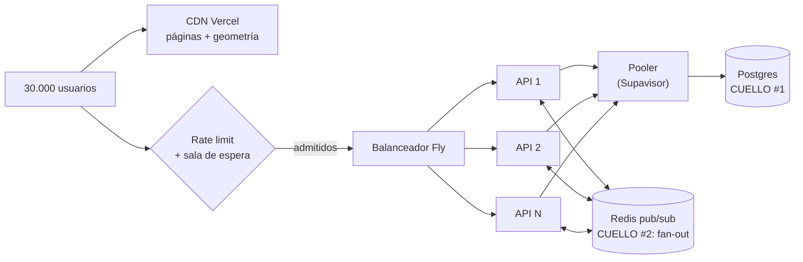
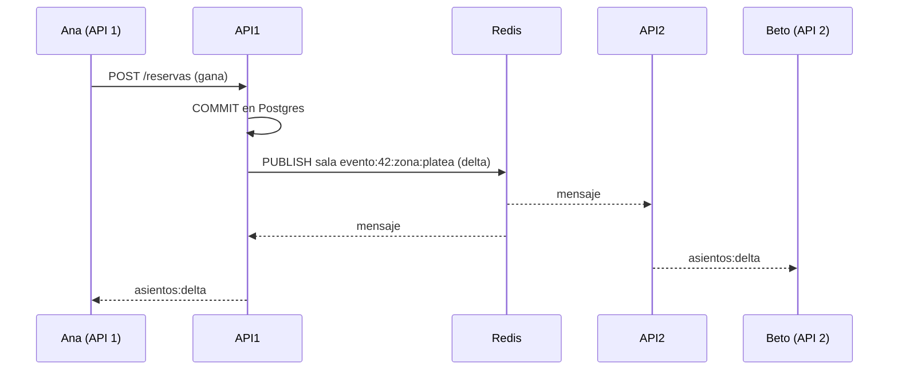

# 06 — Carga y escalabilidad

> Las cifras de este documento son **estimaciones de orden de magnitud** ("cálculos de servilleta") para razonar sobre el diseño. No son mediciones. Las mediciones reales de la demo se registran en `10-pruebas-y-demo.md`.

## 1. Escenario: concierto en el Estadio Félix Capriles (Cochabamba)

| Supuesto | Valor |
|---|---|
| Asientos numerados en venta | 15.000 (peor caso) |
| Personas esperando a la hora de apertura | ~30.000 (2 por asiento) |
| Llegada | El 50 % en el **primer minuto** y el resto en los 10 siguientes |
| Asientos por orden | 2,5 en promedio (máx. 6) |
| Conexión | 80 % móvil (4G con latencia de 60–300 ms y microcortes) |
| Tiempo para agotar las entradas | ~15–30 min |

### Cálculo del pico

| Operación | Cálculo | Pico estimado |
|---|---|---|
| Cargar página del evento + geometría del mapa | 15.000 usuarios en 60 s | ~250 req/s (**la CDN lo absorbe**: es estático) |
| Snapshot del estado del mapa | 15.000 en 60 s, ~4 KB cada uno | ~250 req/s · ~1 MB/s |
| Conexiones WebSocket simultáneas | 30.000 × 70 % con la pestaña abierta | **~20.000 conexiones** |
| Intentos de reserva | Cada usuario intenta 2–4 veces (muchos 409) en los primeros 2 min | **~500–1.000 req/s** de pico |
| Reservas exitosas | 15.000 / 2,5 = 6.000 órdenes en ~15 min | ~7 órdenes/s promedio, ~50/s en el pico |
| Cambios de asiento | 15.000 reservas + liberaciones + ventas | ~20–60 cambios/s |
| Webhooks | = órdenes pagadas | ~5–20/s |
| Emails y PDF | = órdenes pagadas | ~5–20 jobs/s (**se encolan**; pueden tardar minutos) |

### Lo que revela el cálculo
- **El problema no son las escrituras de reserva** (~1.000/s): Postgres resuelve UPDATEs de una fila por clave primaria a miles por segundo **con hardware dedicado**.
- **El problema grande es la difusión (*fan-out*) del WebSocket:** 40 cambios/s × 20.000 clientes = **800.000 mensajes/s** si se envía cada cambio a cada cliente. Inviable.
- **El segundo problema es la "manada"** que golpea en el mismo segundo y los reintentos agresivos.

## 2. Cuellos de botella y mitigaciones

| # | Cuello de botella | Síntoma | Mitigación en el diseño |
|---|---|---|---|
| 1 | **Conexiones a Postgres** | `too many connections`, latencia alta | Pool pequeño **por instancia** (p. ej. 10), el pooler de Supabase en modo transacción y transacciones **cortas** (sin esperar al usuario dentro de una) |
| 2 | **Contención de filas "calientes"** | Los mejores asientos (fila A, centro) reciben cientos de intentos | `SKIP LOCKED`: el perdedor **no espera**, recibe 409 en ms. El cliente sugiere "asientos libres cercanos" |
| 3 | **Fan-out del WebSocket** | CPU de la API al 100 % y mensajes atrasados | **Agrupación (*coalescing*)**: los cambios de cada evento se juntan cada 250 ms en **un** delta. Envío del cambio solo a la **sala de la zona** que el usuario está mirando (`evento:42:zona:platea`). Formato compacto |
| 4 | **Snapshot del mapa** | Muchas lecturas iguales a la vez | Caché del snapshot en memoria de cada instancia con **TTL de 1 s** + `version`. 1.000 lecturas/s se convierten en 1 consulta/s por instancia (*microcaching*) |
| 5 | **Reintentos agresivos del cliente** | Tormenta de 409 y 429 | Backoff + *jitter* en el cliente. Botón deshabilitado mientras hay una petición en curso. `Retry-After` en 429 |
| 6 | **Email / PDF** | Proveedor lento o con cuota diaria | Cola: la venta **no espera**. El usuario ve la entrada en "Mis entradas" aunque el email tarde |
| 7 | **Webhooks en ráfaga** | Muchos POST del proveedor | Transacción corta, respuesta rápida y trabajo pesado en la cola |

## 3. Escalado horizontal

### API (sin estado)
- Las instancias de la API **no guardan estado en memoria** que importe: el JWT viaja en cada petición, la verdad está en Postgres y el pub/sub en Redis.
- Se pueden añadir instancias con `fly scale count 3`. El balanceador reparte.
- Lo único "con estado" es la conexión WebSocket, y se resuelve con el adaptador Redis (abajo).

### Worker
- Varias instancias del Worker consumen la misma cola. BullMQ garantiza que **cada job lo toma un solo Worker** a la vez (con un lock interno y renovación).
- La concurrencia por Worker se configura (`concurrency: 5` para PDF).

### Postgres
- **Vertical primero** (más CPU/RAM): es lo más simple y suficiente para la Fase 1–2.
- **Réplicas de lectura** para el catálogo y "mis entradas" en la Fase 4. **Nunca** para reservar: una réplica con retraso daría estados viejos. Las reservas **siempre** van al primario.
- **Particionado** por evento (o por departamento) solo si llegáramos a tablas de cientos de millones de filas. **No hace falta** en ninguna fase prevista.

## 4. WebSocket con varias instancias

**Problema:** Ana está conectada a la API 1 y Beto a la API 2. Si la reserva de Ana ocurre en la API 1, ¿cómo se entera Beto?

**Opciones:**
1. *Sticky sessions* + que cada instancia consulte la BD periódicamente: retraso y carga.
2. **Adaptador Redis de Socket.IO** (pub/sub): cada instancia publica en Redis y todas reciben.
3. Un servicio de tiempo real externo (Pusher, Ably, Supabase Realtime): rompe el objetivo didáctico y tiene límites de free tier.

**Elección:** 2, `@socket.io/redis-adapter`.

- **Si Redis cae:** cada instancia solo informa a sus propios sockets, y los clientes notan "silencio" y pasan a polling (doc 05). **Nada se vende mal.**
- **Límite por instancia:** una instancia Node con 256–512 MB sostiene del orden de miles de conexiones WS inactivas. Para 20.000 harían falta varias instancias más grandes. Esto **no** es alcanzable en el free tier y se documenta como proyección.

## 5. Rate limiting y control de admisión

### Rate limiting (implementado)
- `@nestjs/throttler` con almacenamiento en **Redis** (compartido entre instancias).

| Endpoint | Límite | Clave |
|---|---|---|
| `POST /auth/login` | 5/min | IP + email (contra fuerza bruta) |
| `POST /eventos/:id/reservas` | 10/min | usuario. Además 30/min por IP (protege contra bots con muchas cuentas) |
| `GET /eventos/:id/asientos` | 60/min | IP |
| `POST /validaciones` | 120/min | validador |

- Algoritmo: **ventana deslizante** o **token bucket**. Respuesta: `429` + `Retry-After`.
- **Si Redis cae:** el throttler sigue con un contador **en memoria por instancia** (degradado, menos preciso). Se prefiere esto a rechazar todo.
- **IP compartida (CGNAT):** en redes móviles bolivianas muchos usuarios salen por la **misma IP pública** del operador. Por eso el límite por IP es generoso y el límite principal es **por usuario**.

### Sala de espera virtual (diseño para producción, opcional en la demo)
En lugar de dejar entrar a 30.000 personas a la vez, se las **admite a ritmo controlado** (p. ej. 500 cada 10 s):
1. A la hora de apertura, el usuario recibe un **turno** (`ZADD sala:42 <timestamp> <usuario>` en Redis).
2. Un proceso admite a los primeros N y les da un **token de admisión** firmado con validez de 10 min.
3. `POST /reservas` exige ese token.

Aquí Redis **sí** tiene sentido: el orden de la fila es una optimización de experiencia, no una garantía de correctitud. Si se pierde, se reconstruye y nadie pierde un asiento ya reservado.

## 6. Redes móviles en Bolivia

| Problema | Diseño |
|---|---|
| Latencia alta y variable | API y BD en **São Paulo** (la región disponible más cercana). Lo estático en la CDN. **Una** petición por acción (reservar = 1 POST) |
| Microcortes al moverse o cambiar de antena | Reconexión con backoff + *jitter*. Resync por `version` |
| Datos móviles caros | Snapshot compacto (~4 KB), geometría cacheada, sin librerías pesadas en la página del mapa (meta < 200 KB JS) |
| Celulares de gama media o baja | Mapa dibujado en **canvas** o SVG simple (no 15.000 nodos DOM con eventos). Virtualización por zona |
| Pestaña en segundo plano | Se cierra el WS y se pasa a polling lento (60 s) para ahorrar batería |
| CGNAT | Rate limit principal por usuario (arriba) |
| Respuesta perdida en la reserva | `Idempotency-Key` (doc 04 §7) |

## 7. Proyección nacional (Fase 4)

Varios eventos simultáneos: un concierto en Santa Cruz, un partido en La Paz y una obra en Sucre.

- **Aislamiento por evento:** salas WS, caché de snapshot y claves de rate limit se definen **por evento**, y las filas de `asientos` de eventos distintos **no compiten** por locks. Dos eventos grandes simultáneos suman carga en Postgres pero **no** contienden entre sí.
- **Postgres:** es el cuello que más crece. Plan: 1) más CPU · 2) réplicas de lectura para el catálogo · 3) solo si hiciera falta, separar el inventario de eventos "masivos" en su propia base.
- **Región:** un solo país, así que una región basta. Multi-región **no** aporta valor: la latencia Bolivia–São Paulo es aceptable y la multi-región complica la consistencia.
- **Microservicios:** recién aquí empieza a tener sentido extraer **Validación** (picos a la hora de entrada en muchos recintos) y **Notificaciones** (ver doc 03 §5).

## 8. Qué demostramos en clase vs. qué es proyección

| Aspecto | Demo (medido) | Producción (proyectado) |
|---|---|---|
| Concurrencia sobre un asiento | 50 → 1 ganador ✅ | Igual: la lógica no cambia con la escala |
| Reservas/s | Decenas (free tier) | Cientos o miles con Postgres dedicado |
| Conexiones WS | Decenas (navegadores + script) | Decenas de miles con N instancias |
| Multi-instancia | 2 instancias de API en Fly ✅ | N instancias |
| Sala de espera | Opcional | Necesaria para eventos > 5.000 asientos |
