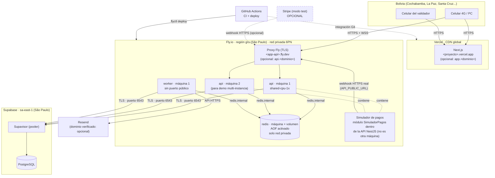
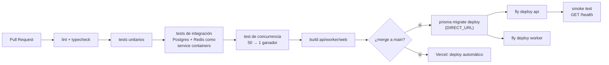

# 07 — Despliegue

> **Datos verificados el 16/10/2026** con las páginas oficiales de cada proveedor (fuentes al final). Los free tiers cambian seguido: **vuelvan a verificarlos en la semana 1**.
> **Presupuesto acordado:** hasta ~US$5–10/mes durante las semanas de demo.

## 1. Diagrama de despliegue

## 2. Regiones más cercanas a Bolivia (verificado)

| Servicio | ¿Tiene Sudamérica? | Región elegida | Comentario |
|---|---|---|---|
| **Fly.io** | ✅ `gru` São Paulo | `gru` | Única plataforma de cómputo de la lista con región en Sudamérica |
| **Supabase** | ✅ `sa-east-1` São Paulo | `sa-east-1` | Misma ciudad que Fly `gru`: latencia API↔BD de pocos ms |
| **Vercel** | ✅ `gru1` São Paulo (región de funciones) | CDN global + funciones en `gru1` si el plan lo permite (verificar en Hobby) | Las funciones van por defecto a `iad1` (Washington). Casi todo lo nuestro es estático o SSR liviano |
| **Render** | ❌ Oregon, Ohio, Virginia, Frankfurt, Singapur | — | Lo más cercano es Virginia/Ohio |
| **Railway** | ❌ US West, US East (Virginia), EU West (Ámsterdam), SE Asia (Singapur) | — | Lo más cercano es US East |
| **Upstash** | No confirmado en la página de precios | — | No pudimos verificar `sa-east-1`. Ver la consola |
| **Resend** | N/A (API) | — | La latencia del email no importa: es asíncrono |

**Por qué importa la región:** la latencia de red desde Bolivia a São Paulo suele ser bastante menor que a Virginia (EE. UU.). **Mídanla** desde Cochabamba con `curl -w "%{time_connect}"` contra cada región en la semana 1 y anoten el resultado aquí. Cada reserva, cada delta del WS y cada reconexión pagan esa latencia de ida y vuelta.

Más importante todavía: **API y BD en la misma región.** Una reserva hace 2–4 consultas. Si la API está en Virginia y la BD en São Paulo, cada consulta cruza el continente.

## 3. Free tiers y precios verificados

| Proveedor | Plan | Qué incluye (oficial) | Trampa para nuestro caso |
|---|---|---|---|
| **Vercel** | Hobby (gratis) | 100 GB de transferencia, 1M de invocaciones, duración máx. de 300 s | **Solo uso personal no comercial.** Cobrar a visitantes = uso comercial. Sirve para el proyecto universitario. Producción necesita Pro |
| **Fly.io** | Pago por uso | **Sin free tier para organizaciones nuevas.** Prueba de 2 h de máquina o 7 días | Requiere tarjeta. Costo estimado: 3–4 máquinas pequeñas siempre encendidas + volumen de 1 GB. **Calculen con la calculadora de Fly** (estimamos ~US$5–10/mes) |
| **Supabase** | Free | 500 MB de BD, 5 GB de egress, **2 proyectos activos**, región São Paulo | **Se pausa tras 1 semana de inactividad.** Entrar al panel antes de la demo. Free no lista límites de conexiones directas: usar el pooler |
| **Railway** | Trial / Free / Hobby | Trial: US$5 únicos. Free: US$1/mes (0,5 GB RAM por servicio). Hobby: US$5/mes con US$5 de uso incluido | Sin región en Sudamérica. El Free de US$1 no alcanza para API + Worker + Redis 24/7 |
| **Render** | Free | 750 h/mes por workspace. Se duerme tras 15 min sin tráfico (incluye mensajes WS). Arranque de ~1 min. Postgres gratis de 1 GB que **expira a los 30 días**. Key Value en memoria (**pierde datos al reiniciar**) | Sin workers gratis. Un arranque en frío de ~1 min en plena demo es fatal |
| **Upstash Redis** | Free | 256 MB, **500K comandos/mes**, 10 GB de ancho de banda | **BullMQ consulta Redis constantemente aunque no haya jobs** (lo advierte la doc de Upstash). Hay usuarios que agotaron la cuota en reposo. **No apto** para BullMQ en el plan gratis |
| **Resend** | Free | **3.000 emails/mes, máx. 100/día**, 3 dominios, 30 días de logs | 100/día: en los ensayos de demo **no** usen emails reales masivos (usar Mailpit en local) |
| **SendGrid** | — | **Retiró el plan gratis en 2025.** Ahora es una prueba de 60 días | Descartado |
| **Simulador de pagos** | Propio | Módulo dentro de la API NestJS: no es otro servicio ni otra máquina, **sin costo extra** | Es el proveedor principal de la demo (ADR-0015) |
| **Stripe** (opcional) | Modo test | Solo si se puede abrir la cuenta de test desde Bolivia (prueba T11 de la semana 1) | Bolivia **no** figura entre los países con cuenta Stripe y el registro pide un país soportado. Nunca modo live. Ver doc 13 |

## 4. Elección final

**Problema:** queremos baja latencia para Bolivia, API + Worker + Redis **siempre encendidos** (sin arranques en frío en la demo), y un presupuesto de ≤ US$10/mes.

**Opciones:**
1. **Fly.io `gru`** (API + Worker + Redis) + Supabase `sa-east-1` + Vercel + Resend.
2. **Railway Hobby** (API + Worker + Redis, US East) + Supabase + Vercel + Resend.
3. Todo gratis: Render (API) + Upstash (Redis) + Worker local.

**Elección:** **opción 1**, con la **opción 2 como plan B** si la tarjeta o el costo de Fly dan problemas.

**Por qué:**
- Fly es la única plataforma con cómputo en São Paulo, en la **misma ciudad** que Supabase.
- Redis en Fly dentro de la **red privada**: sin límites por comando (BullMQ consume en reposo), sin exponer Redis a Internet y con latencia mínima.
- Varias máquinas de la API en una línea (`fly scale count 2`): demostramos el WebSocket multi-instancia de verdad.
- La opción 3 se descarta: los arranques en frío de Render, la cuota de comandos de Upstash y un Worker en la laptop de alguien hacen la demo frágil.

**Plan B (Railway):** misma arquitectura, región US East. Interfaz más simple y plantilla de Redis. Costo fijo de US$5 con US$5 de uso incluido. Se paga con latencia mayor desde Bolivia.

**Plan C (contingencia el día de la demo):** todo en una laptop con Docker. Los pagos usan el simulador (módulo de la API) con `API_PUBLIC_URL=http://localhost:3000`: el webhook va por HTTP a la propia API local, sin túneles ni cuentas externas. `stripe listen` solo hace falta si además se demuestra el adaptador opcional de Stripe. Debe estar ensayado.

## 5. URLs y dominio (el dominio propio es opcional)

**Por defecto se usan las URL gratuitas** que dan las plataformas, sin comprar nada:

| Servicio | URL por defecto | Para |
|---|---|---|
| Frontend | `https://<proyecto>.vercel.app` | Next.js en Vercel |
| API + WebSocket | `https://<app-api>.fly.dev` (`wss://` para el WS) | Máquinas `api` en Fly, con TLS incluido |

**Variante opcional, con dominio propio:**

| Registro | Apunta a | Para |
|---|---|---|
| `app.<dominio>` | Vercel (CNAME) | Frontend |
| `api.<dominio>` | Fly (`fly certs add api.<dominio>`) | API + WebSocket |
| TXT/MX/CNAME de Resend (SPF, DKIM, DMARC) | Resend | Enviar a cualquier destinatario y que los emails **no caigan en spam** |

- Con las URL gratuitas, el frontend y la API quedan en **sitios distintos** (`vercel.app` y `fly.dev`). No es un problema: CORS se configura con `CORS_ORIGINS` y el JWT viaja en la cabecera `Authorization`, no en cookies. Con dominio propio, los subdominios del mismo dominio permitirían cookies *same-site* en el futuro (ADR-0009).
- Cambiar de una variante a la otra es **solo configuración**: `CORS_ORIGINS`, `API_PUBLIC_URL`, `NEXT_PUBLIC_API_URL` y `NEXT_PUBLIC_WS_URL`.

### Riesgo: el email podría exigir un dominio verificado

- **Riesgo:** sin dominio propio verificado, el proveedor de email (Resend) podría permitir enviar **solo a la dirección de la cuenta** (o desde una dirección de prueba), no a cualquier destinatario. Verificarlo en su documentación actual al configurar la cuenta. El comprador de la demo no recibiría su entrada por email.
- **Mitigación:**
  - **En desarrollo:** Mailpit (doc 07 §8). No usa Resend ni requiere dominio.
  - **En la demo:** enviar solo a correos del equipo (los compradores de la demo son cuentas del equipo), **o** comprar un dominio barato y verificarlo en Resend (SPF/DKIM) antes de la semana 4.
  - En cualquier caso, la entrada se ve en "Mis entradas" aunque el email no llegue: el email no es parte de la correctitud.

## 6. Variables de entorno

| Variable | Dónde | Ejemplo / nota | Secreto |
|---|---|---|---|
| `NODE_ENV` | api, worker | `production` | No |
| `APP_ROLE` | api, worker | `api` o `worker` (mismo build, distinto arranque) | No |
| `DATABASE_URL` | api, worker | Pooler de Supabase, modo transacción (`:6543`, `?pgbouncer=true&connection_limit=10`) | ✅ |
| `DIRECT_URL` | CI (migraciones) | Pooler en modo sesión (`:5432`) para `prisma migrate deploy` | ✅ |
| `REDIS_URL` | api, worker | `redis://:<pass>@<app-redis>.internal:6379` | ✅ |
| `JWT_SECRET` | api | ≥ 32 bytes aleatorios | ✅ |
| `JWT_EXPIRES_IN` | api | `60m` | No |
| `QR_SIGNING_PRIVATE_KEY` | **solo worker** | Ed25519 en PEM | ✅ |
| `QR_SIGNING_PUBLIC_KEY` | api | Ed25519 en PEM | No |
| `PAYMENT_PROVIDERS` | api | Adaptadores habilitados, p. ej. `simulador,stripe` (valores: `simulador` \| `stripe` \| `qr`) | No |
| `PAYMENT_PROVIDER_DEFAULT` | api | `simulador`: el proveedor de los pagos nuevos (`simulador` \| `stripe` \| `qr`). Debe estar incluido en `PAYMENT_PROVIDERS`, si no la API no arranca. Cada proveedor habilitado recibe sus webhooks en `POST /webhooks/pagos/:proveedor` | No |
| `STRIPE_SECRET_KEY` | api | `sk_test_...` (**nunca** `sk_live_`; la API se niega a arrancar si detecta `live`) | ✅ |
| `STRIPE_WEBHOOK_SECRET` | api | `whsec_...` | ✅ |
| `SIMULADOR_HABILITADO` | api | `true` en local y demo: monta el módulo `SimuladorPagos`. Con un proveedor real, `false` | No |
| `API_PUBLIC_URL` | api | `https://<app-api>.fly.dev` (opcional: `https://api.<dominio>`; local: `http://localhost:3000`). El simulador envía el webhook a esta URL | No |
| `SIMULADOR_WEBHOOK_SECRET` | api | Secreto de la firma HMAC-SHA256 del simulador (`t=<ts>,v1=…` sobre `<ts>.<rawBody>`) | ✅ |
| `RESEND_API_KEY` | worker | `re_...` | ✅ |
| `EMAIL_FROM` | worker | Con dominio verificado: `Entradas <entradas@<dominio>>`. Sin dominio: la dirección de prueba que permita Resend (solo envía a correos del equipo, ver §5) | No |
| `CORS_ORIGINS` | api | `https://<proyecto>.vercel.app` (opcional: `https://app.<dominio>`) | No |
| `RATE_LIMIT_RESERVAS_IP` | api | `30` reservas/min por IP; **≥ `100` en el entorno de demo** (la carrera sale de una sola IP) | No |
| `RESERVA_TTL_SEGUNDOS` | api | `300` (en tests: `5`) | No |
| `TZ_DISPLAY` | api, worker, frontend | `America/La_Paz` | No |
| `NEXT_PUBLIC_API_URL` | frontend | `https://<app-api>.fly.dev` (opcional: `https://api.<dominio>`) | No |
| `NEXT_PUBLIC_WS_URL` | frontend | `wss://<app-api>.fly.dev` (opcional: `wss://api.<dominio>`) | No |

Reglas: los secretos van en `fly secrets set` / Vercel Env / GitHub Secrets, **nunca** en el repo. Se versiona un `.env.example` sin valores. El servidor corre con `TZ=UTC`.

## 7. CI/CD con GitHub Actions

| Paso | Detalle | Por qué |
|---|---|---|
| Service containers | `postgres:16` y `redis:7` en el job | Los tests de concurrencia **deben** correr contra un Postgres real. Un mock no tiene locks |
| Test de concurrencia obligatorio | Bloquea el merge si falla | Es la propiedad central del proyecto |
| Migraciones antes del deploy | Migraciones **compatibles hacia atrás** (añadir columnas, no renombrar en un solo paso) | Durante el deploy conviven la versión vieja y la nueva |
| Deploy por rama | `main` → producción de la demo. PR → Vercel preview | — |
| Protección de rama | `main` exige PR + CI en verde + 1 revisión | Trabajo en equipo |

## 8. Desarrollo local con Docker

Servicios del entorno local (se definen en la semana 1):

| Servicio | Imagen | Para |
|---|---|---|
| postgres | `postgres:16` | BD |
| redis | `redis:7` con AOF | Cola y pub/sub |
| mailpit | `axllent/mailpit` | Ver los emails sin gastar la cuota de Resend |
| stripe-cli | `stripe/stripe-cli` | `stripe listen --forward-to localhost:3000/webhooks/pagos/stripe` |
| bull-board | dentro de la API en `/admin/colas` (protegido por rol) | Ver la cola en la demo |
| api, worker, web | Se corren con `npm run dev` fuera de Docker (más rápido para desarrollar) | — |

## 9. Observabilidad mínima

- **Logs:** JSON con `pino`, con `requestId`, `ordenId`, `eventoId` y `instancia` (`FLY_MACHINE_ID`). Se ven con `fly logs`.
- **Métricas:** endpoint `/metrics` (formato Prometheus) con:
  - `reservas_total{resultado="ok|conflicto|rate_limited"}`
  - `webhooks_total{resultado="nuevo|duplicado|firma_invalida"}`
  - `cola_jobs{cola, estado}` · `ws_conexiones{instancia}` · `http_request_duration_seconds`
- **Panel de demo:** página `/admin/demo` en el frontend que consulta `/metrics` cada 2 s y muestra contadores grandes. Grafana **no aporta lo suficiente** para el esfuerzo en 6 semanas: es opcional si sobra tiempo.

## 10. Fuentes (consultadas el 16/10/2026)

- Stripe, países soportados: <https://stripe.com/global>
- Render, regiones: <https://render.com/docs/regions> · free: <https://render.com/docs/free>
- Railway, regiones: <https://docs.railway.com/reference/regions> · planes: <https://docs.railway.com/reference/pricing/plans>
- Fly.io, regiones: <https://fly.io/docs/reference/regions/> · precios: <https://fly.io/docs/about/pricing/>
- Supabase, precios: <https://supabase.com/pricing> · regiones: <https://supabase.com/docs/guides/platform/regions>
- Upstash, precios Redis: <https://upstash.com/pricing/redis> · BullMQ en Upstash: <https://upstash.com/docs/redis/integrations/bullmq>
- Resend, precios: <https://resend.com/pricing>
- Vercel, límites: <https://vercel.com/docs/limits> · Hobby: <https://vercel.com/docs/plans/hobby> · uso justo: <https://vercel.com/docs/limits/fair-use-guidelines> · regiones: <https://vercel.com/docs/regions>
- SendGrid, retiro del plan gratis: <https://www.twilio.com/en-us/changelog/sendgrid-free-plan>
- Consumo de BullMQ en Upstash (foro de Fly): <https://community.fly.io/t/pay-as-you-go-pricing-for-redis-databases/16253>
