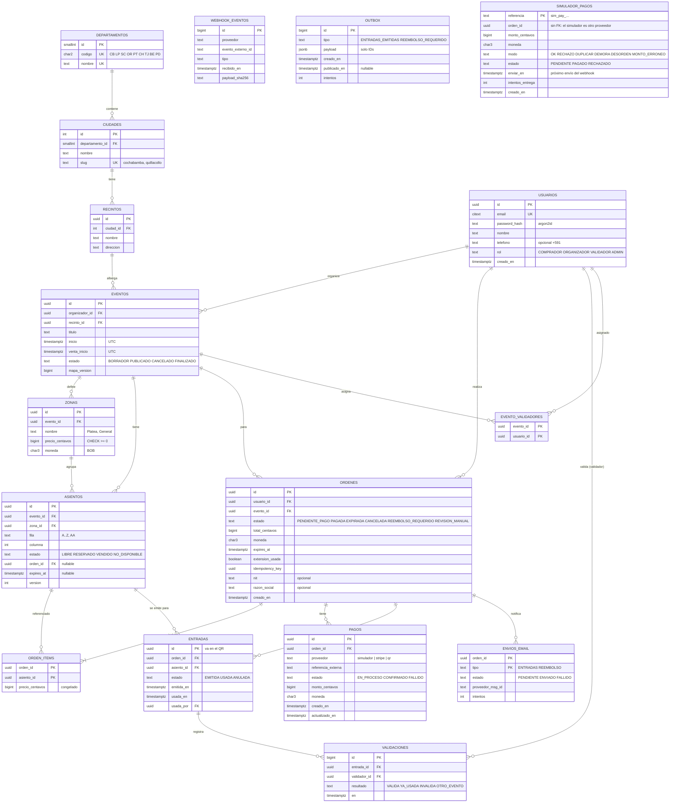

# 09 — Modelo de datos

## 1. Convenciones

| Convención | Regla | Ejemplo | Por qué |
|---|---|---|---|
| **Dinero** | `bigint` en **centavos** + `moneda char(3) DEFAULT 'BOB'` | Bs 150,50 → `15050` | `0.1 + 0.2 = 0.30000000000000004` en float. Con enteros la suma es exacta. `bigint` sobra, pero evita sorpresas al sumar la recaudación |
| **Fechas** | `timestamptz` (se guarda en UTC) | `2026-11-22 01:00:00+00` = sáb. 21/11 21:00 en Bolivia | Comparar instantes sin ambigüedad. La conversión a `America/La_Paz` se hace solo al mostrar |
| **Hora del servidor** | Las comparaciones de vencimiento usan `now()` de Postgres | `expires_at < now()` | Un solo reloj autoritativo |
| **IDs** | `uuid` (v7 si está disponible, si no v4) para entidades expuestas. `bigserial` para tablas internas (outbox, eventos de webhook) | `entradas.id` va en el QR | No enumerables (nadie adivina la entrada 1235 a partir de la 1234) |
| **Estados** | `text` + `CHECK (estado IN (...))` (o enum de Postgres) | — | Legible en logs y migraciones simples |
| **Nombres** | `snake_case`, en español | `orden_items` | Coherencia con el dominio |
| **Teléfono** | `text` E.164 opcional, `CHECK (telefono ~ '^\+591[0-9]{8}$')` | `+59171234567` | Formato boliviano. Opcional por minimización de datos |

## 2. Diagrama ER



`simulador_pagos` es del módulo `SimuladorPagos` (solo local/demo). **A propósito** no tiene relaciones con las demás tablas: simula un proveedor externo, que no ve nuestra base de datos. Así el módulo se puede extraer a otro servicio sin migrar claves foráneas (ADR-0015).

**Estados de la orden y del pago:** la orden **no** tiene estado FALLIDA. Un rechazo se registra en el pago (`pagos.estado = 'FALLIDO'`) y la orden sigue PENDIENTE_PAGO hasta su `expires_at`, así el comprador puede reintentar con un nuevo pago (sin nueva extensión: `extension_usada`). Detalle en doc 04 §1 y §4.3.

## 3. Ciudad y departamento: listos para la expansión

- **Semilla inicial:** los 9 departamentos (`CB` Cochabamba, `LP` La Paz, `SC` Santa Cruz, `OR` Oruro, `PT` Potosí, `CH` Chuquisaca, `TJ` Tarija, `BE` Beni, `PD` Pando) y las ciudades de Cochabamba (Cochabamba, Quillacollo, Sacaba...).
- **Filtro:** `GET /eventos?ciudad=cochabamba` resuelve el `slug` y hace un JOIN `eventos → recintos → ciudades`. Con `?departamento=CB` lista todo el departamento.
- **Expandir a Tarija** = insertar filas en `ciudades` y crear recintos. Cero cambios de código (RNF-14).
- **¿Por qué no un `text ciudad` libre en el evento?** Porque "Cbba", "Cochabamba" y "cochabamba " serían tres ciudades distintas, y el filtro fallaría.

## 4. Restricciones clave (el corazón de la correctitud)

| Restricción | SQL (resumen) | Protege |
|---|---|---|
| Asiento único en el mapa | `UNIQUE (evento_id, fila, columna)` en `asientos` | No hay dos "F-12" en el mismo evento |
| Una entrada válida por asiento | `CREATE UNIQUE INDEX ... ON entradas(asiento_id) WHERE estado IN ('EMITIDA','USADA')` | **RN-01**, la invariante principal |
| Coherencia de estado | `CHECK` de estado / `orden_id` / `expires_at` (doc 04 §4.2) | Estados imposibles |
| Webhook procesado una vez | `UNIQUE (proveedor, evento_externo_id)` en `webhook_eventos` | Duplicados del proveedor |
| Un cobro, un pago | `UNIQUE (proveedor, referencia_externa)` en `pagos` | Dos eventos distintos del mismo cobro |
| Idempotencia de la reserva | `UNIQUE (usuario_id, idempotency_key)` en `ordenes` | Doble clic y reintentos de red |
| Una orden pendiente por evento | `CREATE UNIQUE INDEX ... ON ordenes(usuario_id, evento_id) WHERE estado='PENDIENTE_PAGO'` | **RN-04** (acaparamiento). Para no depender del job, la reserva marca antes EXPIRADA la orden pendiente **vencida** del mismo usuario y evento (doc 04 §4.1). Este mismo índice acelera esa búsqueda |
| Un ítem por asiento por orden | PK `(orden_id, asiento_id)` | Asiento repetido en la misma orden |
| El asiento apunta a una orden existente | `asientos.orden_id` → `ordenes(id)`: clave foránea **normal, no diferible** | Un asiento nunca apunta a una orden inexistente. Por eso la reserva inserta **primero** la orden y después marca los asientos. Si faltan asientos, el ROLLBACK deshace las dos cosas (doc 04 §4.1) |
| Montos no negativos | `CHECK (precio_centavos >= 0)`, `CHECK (total_centavos >= 0)` | Errores de signo |
| Moneda | `CHECK (moneda = 'BOB')` (por ahora) | Mezclar monedas |
| Email único | `citext UNIQUE` | `Ana@x.com` = `ana@x.com` |
| Un email por orden y tipo | PK `(orden_id, tipo)` en `envios_email` | Doble envío |

## 5. Índices

| Índice | Consulta que acelera |
|---|---|
| `asientos (evento_id, estado)` | Snapshot del mapa y conteos del panel |
| `asientos (expires_at) WHERE estado='RESERVADO'` (parcial) | Job `liberar-vencidas`: solo indexa lo reservado (pequeño) |
| `asientos (orden_id)` | Confirmar el pago: `WHERE orden_id = $1` |
| `eventos (estado, inicio)` + `recintos (ciudad_id)` | Listado por ciudad |
| `ordenes (estado, expires_at) WHERE estado='PENDIENTE_PAGO'` | Marcar órdenes EXPIRADAS |
| `outbox (id) WHERE publicado_en IS NULL` (parcial) | Relay: solo las pendientes |
| `pagos (proveedor, creado_en) WHERE estado='EN_PROCESO'` (parcial) | Reconciliación: pagos EN_PROCESO cuyo `creado_en` supera el `umbralReconciliacion` de su proveedor |
| `entradas (orden_id)` | "Mis entradas", generar el PDF |

**¿Por qué índices parciales?** En el pico, de 15.000 asientos quizá 2.000 están RESERVADOS. Un índice que solo incluye esos es pequeño, cabe en memoria y el job lo recorre en milisegundos.

## 6. Ejemplos de datos

```text
departamentos: (1, 'CB', 'Cochabamba')
ciudades:      (1, 1, 'Cochabamba', 'cochabamba'), (2, 1, 'Quillacollo', 'quillacollo')
recintos:      (r1, 1, 'Estadio Félix Capriles', 'Av. Libertador Bolívar')
eventos:       (e42, org1, r1, 'Concierto de Primavera', '2026-11-22 01:00Z', '2026-11-01 14:00Z', 'PUBLICADO', 812)
                -- se muestra: sábado 21/11/2026 21:00 · venta: domingo 01/11 10:00 (hora de Bolivia)
zonas:         (z1, e42, 'Platea', 30000, 'BOB')   -- Bs 300,00
asientos:      (a1, e42, z1, 'F', 12, 'RESERVADO', o77, '2026-11-01 14:05:00Z', 8)
ordenes:       (o77, ana, e42, 'PENDIENTE_PAGO', 60000, 'BOB', '2026-11-01 14:05Z', false, <uuid>, NULL, NULL)
```

## 7. Datos personales (minimización)

| Dato | ¿Se guarda? | Motivo |
|---|---|---|
| Email | Sí | Login + envío de la entrada |
| Nombre | Sí | Saludo en el email y el PDF |
| Teléfono | Opcional | Contacto. No se usa para nada crítico |
| CI (carnet) | **No** | No lo necesitamos. Si un organizador lo exige, sería una decisión futura con consentimiento explícito |
| Contraseña | Solo el **hash argon2id** | Ni el equipo puede verla |
| Tarjeta | **Nunca** | La maneja el proveedor de pagos (simulador, banco o pasarela) |
| NIT / razón social | Opcional, en la orden | Factura futura |
| QR | Solo `uuid` de entrada, `evento_id`, fecha de emisión y firma | Una foto filtrada del QR no expone a nadie |
| Logs | Sin contraseñas, tokens ni payloads completos de pago | Se registra el `payload_sha256` del webhook, no el cuerpo |

## 8. Migraciones

- Prisma Migrate genera migraciones SQL versionadas en el repo.
- Los **índices parciales, CHECK complejos y `citext`** se agregan con SQL manual dentro de la migración (Prisma no los expresa todos en su esquema). Esto es normal y se documenta en un comentario en la migración.
- Regla para CI: las migraciones deben ser **compatibles hacia atrás** (doc 07).
