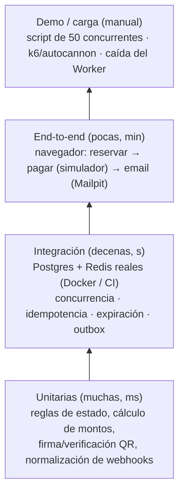

# 10 — Pruebas y demo

## 1. Estrategia

**TDD obligatorio** en concurrencia e idempotencia: el test se escribe **antes** que la implementación y debe fallar primero. Ejemplo: escribir el test de "50 → 1" contra una implementación ingenua (`SELECT` y luego `UPDATE`), ver que **falla** (gana más de uno) y recién después implementar el UPDATE condicional. **Ese "rojo → verde" es material de la presentación:** muestra que el test detecta el bug de verdad.

> **Por qué los tests de concurrencia NO usan mocks:** un mock de la BD no tiene locks, ni aislamiento, ni re-evaluación del WHERE. Probaríamos nuestro mock, no Postgres.

## 2. Casos de prueba críticos

### 2.1 Concurrencia (doc 04)
| ID | Escenario | Resultado esperado |
|---|---|---|
| C-01 | 50 `reservar([F-12])` concurrentes (`Promise.all`, 50 conexiones distintas) | Exactamente **1** éxito y 49 conflictos. En BD: 1 orden PENDIENTE, F-12 RESERVADO con ese `orden_id` |
| C-02 | Órdenes con asientos solapados {1,2,3} y {3,4,5} concurrentes, repetido 100 veces | En cada ronda una gana completa y la otra 409. **Nunca** reservas parciales |
| C-03 | {1,2} y {2,1} concurrentes, 100 veces | Sin deadlock (el test falla si tarda > 5 s) |
| C-04 | Reserva con `expires_at` en el pasado (forzado por SQL) **sin** correr el job | Otra orden puede reservar el asiento (expiración perezosa) |
| C-05 | El job `liberar-vencidas` corre en 2 procesos a la vez sobre 1.000 vencidos | Cada asiento se libera exactamente una vez. Los deltas publicados no se duplican en estado final |
| C-06 | 20 reservas con la misma `Idempotency-Key` | 1 orden. Las 20 respuestas devuelven el mismo `ordenId` |
| C-07 | Un usuario intenta una 2.ª orden pendiente en el mismo evento | 409 `ORDEN_PENDIENTE_EXISTENTE` |
| C-08 | El usuario tiene una orden PENDIENTE_PAGO con `expires_at` en el pasado (forzado por SQL) y el job **no** corrió. Reserva de nuevo en el mismo evento | 201. La orden vieja queda EXPIRADA y la nueva PENDIENTE_PAGO: el índice de RN-04 no bloquea |
| C-09 | La orden O1 venció con los asientos {1,2,3} y llega su webhook (re-captura en orden {1,2,3}) **al mismo tiempo** que una reserva nueva O2 pide {3,2,1}. Repetido 100 veces, más una variante con dos webhooks tardíos de órdenes que comparten asientos | **Ningún deadlock** (sin error `40P01`; el test falla si tarda > 5 s). En cada ronda hay un único dueño de los 3 asientos: si gana O1, O2 recibe 409; si gana O2, O1 queda REEMBOLSO_REQUERIDO. Nunca un reparto parcial |

### 2.2 Idempotencia y pagos (doc 05)
| ID | Escenario | Resultado esperado |
|---|---|---|
| P-01 | Mismo webhook ×5 **en paralelo** (simulador `duplicar`) | 5 × HTTP 200. 1 orden PAGADA. N entradas (N = asientos). 1 fila outbox. Métrica `webhooks_total{resultado="duplicado"} = 4` |
| P-02 | Webhook con firma inválida | 400. Nada cambia |
| P-03 | Webhook llega tarde (reserva vencida). Variantes: a) los asientos siguen RESERVADO con su `orden_id`; b) el job ya los liberó (LIBRE) | En ambas: re-captura de **todos** los asientos. Orden PAGADA, asientos VENDIDO, N entradas |
| P-04 | Webhook llega tarde y **uno** de los N asientos lo tiene otra orden con reserva vigente | REEMBOLSO_REQUERIDO. Ningún asiento queda VENDIDO para esta orden (todo o nada), los que eran suyos se liberan. 0 entradas nuevas. Outbox de disculpa. La fila de `webhook_eventos` sí queda (un reintento es duplicado) |
| P-05 | `FALLIDO` llega después de `EXITOSO` | La orden sigue PAGADA |
| P-06 | Monto del webhook ≠ total de la orden | REVISION_MANUAL. 0 entradas |
| P-07 | Dos eventos distintos con la misma `referencia_externa` | 1 pago, 1 conjunto de entradas |
| P-08 | Arranque con `STRIPE_SECRET_KEY=sk_live_...` | La API **se niega a arrancar** |

### 2.3 Outbox, cola y Worker
| ID | Escenario | Resultado esperado |
|---|---|---|
| W-01 | **Worker detenido**, 3 compras completas | Las 3 órdenes quedan PAGADAS y las entradas visibles en "Mis entradas". 3 jobs en espera en la cola |
| W-02 | Se reinicia el Worker | Los 3 jobs se procesan. 3 emails en Mailpit en < 2 min |
| W-03 | **Redis detenido** durante una compra | La compra se completa. La fila de outbox queda pendiente. Al volver Redis, se publica y procesa |
| W-04 | El relay publica dos veces la misma fila (forzado) | 1 solo job (mismo `jobId`) |
| W-05 | Resend devuelve 503 dos veces y luego 200 | 1 email. `intentos = 3` |
| W-06 | Resend devuelve 422 (email inválido) | Sin reintentos. `FALLIDO` |
| W-07 | El Worker muere (`kill -9`) a mitad de un PDF | BullMQ detecta el job *stalled* y lo reintenta. 1 email final (o duplicado aceptado y documentado) |

### 2.4 Tiempo real y reconexión
| ID | Escenario | Resultado esperado |
|---|---|---|
| R-01 | 2 navegadores conectados a **instancias distintas** (verificar `FLY_MACHINE_ID` en un log) | El cambio en A se ve en B en < 1 s |
| R-02 | DevTools → Offline 20 s → Online | Reconecta solo y pide el delta. El mapa queda igual que el snapshot del servidor |
| R-03 | WS bloqueado (forzar URL inválida) | Tras 3 intentos pasa a polling cada 5 s. El indicador muestra "modo ahorro" |
| R-04 | Delta con hueco de versión (forzado) | El cliente pide resync |
| R-05 | Throttling "Slow 4G" de Chrome | El mapa de 2.000 asientos carga en < 3 s y el JS inicial es < 200 KB |

### 2.5 Expiración
| ID | Escenario | Resultado esperado |
|---|---|---|
| X-01 | `RESERVA_TTL_SEGUNDOS=5`, reservar y esperar 6 s | Otro usuario reserva. El job lo marca EXPIRADA en ≤ 15 s y el mapa se actualiza |
| X-02 | Iniciar el pago extiende +2 min una sola vez | 2.º intento de extensión: sin cambio |
| X-03 | Contador del cliente con el reloj del celular adelantado 3 min | El contador usa el `expiresAt` del servidor menos el desfase medido en la respuesta. La BD decide igual |

### 2.6 Autorización y seguridad
| ID | Escenario | Resultado esperado |
|---|---|---|
| A-01 | Un comprador llama a `POST /admin/eventos` | 403 |
| A-02 | Un comprador cancela la orden de otro usuario | 404 (no se revela que existe) |
| A-03 | Un validador valida una entrada de un evento no asignado | `OTRO_EVENTO` |
| A-04 | JWT vencido o con firma alterada | 401 |
| A-05 | QR con payload modificado (`t` cambiado) | `INVALIDA` (la firma no coincide) |
| A-06 | 2 validadores escanean la misma entrada a la vez | 1 `VALIDA` + 1 `YA_USADA` |
| A-07 | 6 intentos de login en 1 min | El 6.º recibe 429 |
| A-08 | 11 reservas en 1 min del mismo usuario | La 11.ª recibe 429 con `Retry-After` |
| A-09 | Buscar datos personales en el QR decodificado | No hay email, nombre ni teléfono |

### 2.7 Latencia (medición, no aprobado/reprobado)
- Script con autocannon o k6 contra `POST /reservas` sobre asientos **distintos** (para medir rendimiento, no contención): 50 req/s durante 60 s. Registrar p50/p95/p99 del lado del servidor (`http_request_duration_seconds`) y del cliente desde Cochabamba.
- Repetir sobre **un mismo asiento** caliente para medir la latencia del 409.
- Comparar: API en `gru` vs. una prueba en `iad` (si hay tiempo), para justificar la región con datos.

| Medición | Valor (completar) |
|---|---|
| RTT Cochabamba → Fly `gru` | ___ ms |
| RTT Cochabamba → Railway US East (plan B) | ___ ms |
| p95 reserva (servidor) | ___ ms |
| p95 reserva (cliente en Cochabamba, 4G) | ___ ms |
| p95 propagación WS A→B | ___ ms |

## 3. Guion de la demo en vivo (≈ 12 min)

**Preparación (antes de clase):** el proyecto de Supabase está activo (¡no pausado!), 2 máquinas `api` + 1 `worker` en Fly, el evento "Demo SD" con 100 asientos publicado, 2 navegadores abiertos, la terminal con `fly logs` y el panel `/admin/demo` abierto. **`RATE_LIMIT_RESERVAS_IP` ≥ 100** en el entorno de demo (si quedó en 30/min, la carrera muestra 429 en vez de 409). Plan C: la laptop con Docker lista.

| Min | Acto | Qué se ve | Concepto |
|---|---|---|---|
| 0–1 | Contexto | Diagrama del doc 00 | Arquitectura |
| 1–3 | **La carrera** | `node scripts/carrera.js --asiento F-12 --n 50` → `201: 1 · 409: 49` (50 usuarios distintos desde una IP: requiere `RATE_LIMIT_RESERVAS_IP` ≥ 100). Panel: `reservas_total{ok}=1, {conflicto}=49`. Logs de **ambas** instancias | UPDATE condicional, Postgres decide |
| 3–4 | **Mapa en vivo** | Navegador B ve F-12 en gris al instante, aunque está en otra instancia | Pub/sub multi-instancia |
| 4–6 | **Pago + webhook duplicado** | Pagar con el simulador en modo `duplicar=5`. Panel: `webhooks{duplicado}=4`. "Mis entradas": 1 entrada | Idempotencia |
| 6–8 | **Caída del Worker** | `fly machine stop <worker>`. Comprar 3 veces: todo OK. Bull Board: 3 jobs en espera. `fly machine start` → 3 emails llegan | Tolerancia a fallos, outbox |
| 8–9 | **Expiración** | Reserva con TTL de demo (60 s), sin pagar: se libera sola | Lease + expiración perezosa |
| 9–10 | **Red móvil** | DevTools Offline → Online: reconecta y resincroniza | Reconexión + versionado |
| 10–11 | **Puerta** | Escanear el QR desde el celular: VÁLIDA, y de nuevo: YA USADA 21:04 | CAS en la validación |
| 11–12 | Cierre | Tabla del doc 06 §8: demo vs. producción | Honestidad sobre la escala |

**Script `carrera.js` (descripción, se implementa en la semana 2):** usa **50 usuarios distintos** (creados para la prueba o con 50 tokens pre-generados), así el límite por usuario (10/min) no interviene. Como todas las peticiones salen de la misma IP, el entorno debe tener `RATE_LIMIT_RESERVAS_IP` ≥ 100/min. Además, dispara 50 `POST /reservas` en paralelo con `Promise.allSettled`, cuenta los códigos HTTP e imprime una tabla. Luego consulta `GET /asientos` y verifica que F-12 tenga **un** `orden_id`. Debe correr tanto en local como contra producción.

## 4. Definición de "hecho" (DoD) para cada historia
- [ ] Tests (unitarios o de integración) en verde en CI.
- [ ] Si toca concurrencia o idempotencia: test de concurrencia agregado **primero** (TDD).
- [ ] Logs con `requestId` en el camino nuevo.
- [ ] Textos en español de Bolivia, fechas en `America/La_Paz` y montos en Bs.
- [ ] Revisión de código por otro integrante.
- [ ] Documentación actualizada si cambió una decisión (nuevo ADR).
