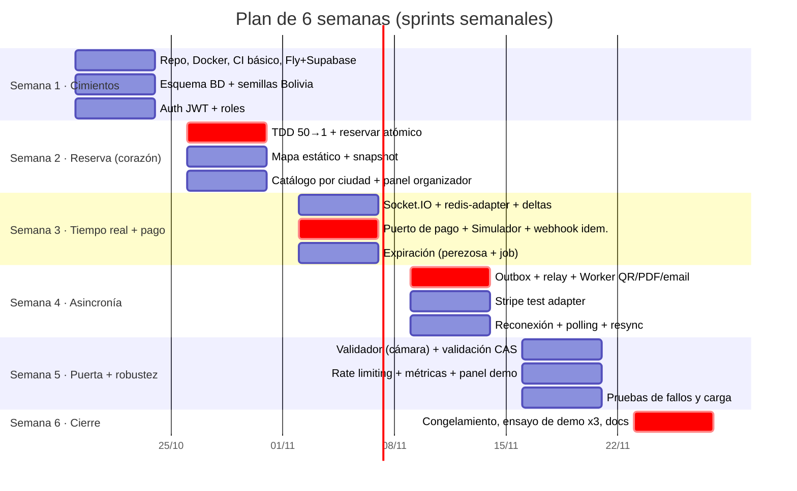

# 11 — Plan de 6 semanas

**Metodología:** Scrum adaptado, con **sprints de 1 semana**.
- **Lunes:** planificación (30 min). Se eligen las historias del backlog.
- **Diaria asíncrona** (mensaje en el grupo: ayer / hoy / bloqueos) + 15 min de llamada martes y jueves.
- **Viernes:** demo interna (cada uno muestra su slice funcionando **desplegado**) + retrospectiva (15 min).
- **TDD** en concurrencia e idempotencia. **Slices verticales:** cada persona entrega una funcionalidad completa (BD → API → UI), no "capas".

## 1. Equipo y responsabilidades

> Reemplazar "Integrante A/B/C" por nombres reales. Cada uno es **dueño** de un área, pero **todos** tocan BD, API y UI en sus slices.

| Persona | Área de responsabilidad | Slices principales |
|---|---|---|
| **Integrante A** | Núcleo de concurrencia y datos | Esquema de BD, reservas, expiración, tests de concurrencia, script de carrera |
| **Integrante B** | Frontend y tiempo real | Next.js, mapa de asientos, Socket.IO + reconexión/polling, panel de demo, validador con cámara |
| **Integrante C** | Pagos, Worker e infraestructura | Adaptadores de pago, webhook idempotente, outbox, Worker (QR/PDF/email), Docker, CI/CD, Fly/Supabase |

Rotación: en las semanas 4–5 cada uno **revisa** el código crítico de otro (A revisa pagos, C revisa reservas, B revisa expiración). Así los tres pueden explicar todo en la defensa.

## 2. Plan por semana

> Fechas de ejemplo (inicio el lunes 19/10/2026). Ajústenlas al calendario real de la materia.

### Semana 1 — Cimientos
| Entregable | Responsable | Criterio de aceptación |
|---|---|---|
| Monorepo (`apps/api`, `apps/worker`, `apps/web`, `packages/shared`), Docker local (Postgres, Redis, Mailpit), README "levantar en 5 min" | C | Otro integrante lo levanta desde cero |
| CI: lint + typecheck + tests con Postgres/Redis como servicios | C | Un PR con un test que falla no se puede mergear |
| Cuentas de Fly, Supabase (`sa-east-1`), Vercel y Resend + dominio. **Verificar de nuevo los free tiers y medir el RTT** desde Cochabamba | C | `GET /health` responde desde `api.<dominio>` |
| Esquema de BD y migraciones con todas las restricciones del doc 09. Semilla con los 9 departamentos y las ciudades de Cochabamba | A | Tests de restricciones: insertar 2 entradas válidas para un asiento **falla** |
| Registro y login con JWT y guard de roles. Next.js con login y layout | B | A-01 y A-04 en verde |

### Semana 2 — Reserva atómica (el corazón)
| Entregable | Resp. | Criterio |
|---|---|---|
| **Test C-01 primero (rojo)** con una implementación ingenua y después el UPDATE condicional (verde). C-02, C-03, C-06 y C-07 | A | Los tests corren en CI |
| `POST /reservas` con `Idempotency-Key` y `DELETE /ordenes/:id` | A | — |
| Script `carrera.js` (50 → 1) | A | Corre contra local y contra Fly |
| Panel organizador: recinto, evento, zonas, grilla y publicar | C | Publicar genera las filas `asientos` |
| Listado por ciudad + detalle + mapa (snapshot REST, sin tiempo real aún) con selección y reserva | B | Comprar el flujo "hasta reservar" en el celular |

**Hito de la semana 2:** la demo de la carrera **ya funciona**. Si el proyecto se cayera aquí, el núcleo está demostrado.

### Semana 3 — Tiempo real + pago
| Entregable | Resp. | Criterio |
|---|---|---|
| `SeatsGateway` con salas por evento, `redis-adapter`, deltas con versión y coalescing de 250 ms | B | R-01 con 2 instancias locales |
| Puerto `ProveedorPago` + `SimuladorAdapter` (OK, rechazo, duplicar, demora, desorden) + webhook idempotente (**TDD: P-01 primero**) | C | P-01..P-07 en verde |
| Expiración perezosa en la reserva y en el snapshot + job `liberar-vencidas` | A | C-04, C-05, X-01 en verde |

### Semana 4 — Asincronía y tolerancia a fallos
| Entregable | Resp. | Criterio |
|---|---|---|
| Outbox + relay (SKIP LOCKED, `jobId`) + Worker: firma QR Ed25519, PDF (es-BO, hora La Paz) y email (Mailpit/Resend) con reintentos | C | W-01..W-06 en verde |
| `StripeTestAdapter` (Checkout en modo test) + `stripe listen` en local | A | Pagar con 4242... emite la entrada |
| Reconexión con backoff + jitter, fallback a polling, resync por versión, contador de reserva | B | R-02..R-04 |

### Semana 5 — Puerta y robustez
| Entregable | Resp. | Criterio |
|---|---|---|
| App del validador (cámara web) + `POST /validaciones` con CAS + asignación de validadores | B | A-03, A-05, A-06 |
| Rate limiting con Redis (+ degradado a memoria) + `/metrics` + panel `/admin/demo` + Bull Board | A | A-07, A-08. El panel muestra contadores |
| Pruebas de fallos en el entorno desplegado (caída del Worker y de Redis) + mediciones de latencia (completar la tabla del doc 10) | C | W-01..W-03 en Fly |

### Semana 6 — Cierre (sin funcionalidades nuevas)
| Entregable | Resp. | Criterio |
|---|---|---|
| **Congelamiento de código el lunes.** Solo correcciones de errores | Todos | — |
| 3 ensayos completos de la demo (uno con el plan C local) | Todos | < 12 min, sin sorpresas |
| Docs actualizados, ADR finales, resumen docente y diapositivas | Todos | El docente puede leer el doc 00 solo |

## 3. Riesgos

| Riesgo | Prob. | Impacto | Mitigación |
|---|---|---|---|
| Free tiers que cambian o Supabase pausado el día de la demo | Media | Alto | Verificar en la semana 1 y el día anterior. Plan C local ensayado |
| Fly pide tarjeta o el costo supera lo previsto | Media | Medio | Plan B Railway (US$5). Alertas de gasto. Apagar máquinas fuera de las semanas de demo |
| El pooler de Supabase en modo transacción + Prisma da problemas (prepared statements) | Media | Medio | `pgbouncer=true` en la URL. Probarlo **en la semana 1**, no en la 5 |
| La concurrencia "funciona en local" pero no en el despliegue | Baja | Alto | `carrera.js` contra Fly desde la semana 2 |
| Un integrante se enferma o abandona | Media | Alto | Slices verticales completos (nada queda a medias en capas). Revisión cruzada para que otro sepa continuar |
| La cuota de Resend (100/día) se agota en los ensayos | Media | Bajo | Mailpit en local y Resend solo en el entorno desplegado. Pocos emails reales |
| El mapa es lento en celulares de gama baja | Media | Medio | Canvas/SVG simple. Probar en el celular más viejo del equipo en la semana 3 |
| Webhooks de Stripe no llegan en local | Media | Bajo | `stripe listen`. El simulador como respaldo |
| Alcance demasiado grande | Alta | Alto | Plan de recorte (abajo) |

## 4. Plan de recorte (si falta tiempo)

Se recorta **de abajo hacia arriba**. Lo de arriba **no se negocia**.

| Prioridad | Funcionalidad | Si falta tiempo... |
|---|---|---|
| 🔒 1 | Reserva atómica + test 50 → 1 | **Nunca se recorta** |
| 🔒 2 | Webhook idempotente con el simulador | **Nunca** |
| 🔒 3 | Outbox + Worker + demo de caída | **Nunca** (es el requisito de tolerancia a fallos) |
| 🔒 4 | Mapa en tiempo real multi-instancia | **Nunca** |
| 5 | Expiración con job | La expiración perezosa basta para la correctitud. El job puede ser más simple |
| 6 | Validador con cámara | Fallback: pegar el texto del QR en un input |
| 7 | Stripe test | Fallback: solo el simulador (el patrón Adapter se demuestra igual) |
| 8 | Polling de respaldo | Solo la reconexión de Socket.IO |
| 9 | PDF | Email con el QR como imagen embebida, sin PDF |
| 10 | Rate limiting distribuido | Throttler en memoria |
| 11 | Panel organizador completo | Eventos cargados por script de semilla |
| 12 | Sala de espera virtual | Solo diseño (ya está en el doc 06) |
