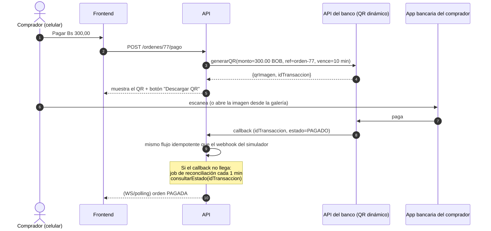

# 13 — Pagos en Bolivia

> Investigación del **16/10/2026**. Las fuentes son oficiales cuando fue posible. Varias son **secundarias** (blogs de agencias locales y prensa) y se marcan como tales. **Antes de un lanzamiento real, todo esto se confirma directamente con el banco o la pasarela.**

## 1. ¿Por qué no Stripe en producción?

- La página oficial de Stripe con los países donde un negocio puede abrir una cuenta (<https://stripe.com/global>) **no incluye a Bolivia**. En Latinoamérica solo figuran **Brasil y México**.
- Consecuencia: un comercio boliviano **no puede** recibir cobros reales con Stripe a su nombre.
- **Uso en el proyecto:** el proveedor de la demo es un **simulador propio** (ADR-0015): un módulo de la API con webhook firmado (HMAC) y modos para duplicar, retrasar, desordenar o rechazar pagos.
- **Stripe test es opcional.** El modo test no exige activar la cuenta ni dar datos bancarios, pero **sí exige abrir una cuenta**, y el registro pide un país soportado. Puede que no sea posible desde Bolivia: se verifica en la prueba T11 de la semana 1. Si se consigue, sirve para mostrar lo mismo con un proveedor real del mercado. **Nunca** se activa el modo live (la API se niega a arrancar con una clave `sk_live_`).
- **Moneda en test (solo si se usa Stripe):** si el Checkout de Stripe en modo test no acepta BOB para la cuenta de prueba (no lo verificamos en su tabla de monedas), se usa USD **solo en el adaptador de Stripe**, con una conversión fija documentada. El dominio sigue en BOB.

## 2. Panorama actual (verificado y no verificado)

### 2.1 QR interoperable (QR Simple): el medio dominante

| Dato | Valor | Fuente |
|---|---|---|
| Operaciones QR en 2025 | **~892 millones** (+131 % frente a 2024) | BCB, Informe de Vigilancia (vía prensa: eju.tv) |
| Monto movido por QR en 2025 | **> Bs 357.747 millones** | BCB (vía eju.tv) |
| Personas que lo usan | ~3,7 millones | ASOBAN (vía prensa) |
| Comercios que lo aceptan | ~1,5 millones | ASOBAN (vía prensa) |
| Participación en pagos | Efectivo 85 % → 64 %, QR 15 % → 36 % (2020 → 2025) | Los Tiempos |
| Ritmo | ~28 pagos QR por segundo | BCB, vía Los Tiempos (jun. 2026) |
| Regulación | El BCB exige un estándar QR común e interoperable en todo el sistema financiero. Resolución de Directorio N.º 111/2024 sobre interoperabilidad | FLAR 2025, BCB |

**Cómo funciona para un comercio:**
- **QR estático** (sin monto): el comercio tiene un QR fijo y el cliente escribe el monto. Requiere **verificación manual**: no sirve para nosotros.
- **QR dinámico** (con monto y referencia por transacción): es lo que necesitamos. Lo genera el banco del comercio por **API**. *Fuente secundaria:* algunos bancos (se menciona al BNB) ofrecen APIs para generar QR dinámicos y **notificar automáticamente** el pago. **No pudimos verificar la documentación técnica pública** (endpoints, formato del callback).
- **Costo:** fuentes locales indican que el QR **no cobra comisión** al comercio ni al cliente (fuente secundaria: bemorex.com). Verificar con cada banco.
- **OpenBCB:** una fuente secundaria describe una plataforma del BCB (lanzada en octubre de 2025) con generación de QR, consulta de estado, notificaciones y APIs de integración, que requiere registro. **No encontramos documentación oficial pública**, así que hay que confirmarlo con el BCB.

### 2.2 Pasarelas locales (tarjetas, banca por internet, efectivo)

| Proveedor | Qué ofrece | Integración | Requisitos y costos | Verificación |
|---|---|---|---|---|
| **PagosNet** | Tarjetas de débito y crédito, portales bancarios, puntos de cobro en efectivo | API / Web Services. Conectores para WooCommerce, Shopify, etc. | **Empresa constituida con NIT**. Comisión en tarjeta de ~3–4 % según las fuentes (no coinciden). Costo de integración único "alrededor de Bs 1.800" | Secundaria (bemorex.com) |
| **Libélula** | Pasarela mencionada junto a QR Simple como opción para e-commerce | No verificada | No verificada | **No se pudo acceder a su sitio** (error de certificado TLS al consultarlo). Mencionada en guías locales |
| **Circle.bo** | Mencionada como opción para e-commerce | No verificada | No verificada | Mencionada en una guía local, sin más datos |
| **Bancos adquirentes** (Visa/Mastercard/Amex) | Cobro con tarjeta, incluidas internacionales | Contrato directo con el banco | Comisiones "algo más altas" y habilitación más exigente | Secundaria |

### 2.3 Billeteras

| Billetera | Situación | API para comercios |
|---|---|---|
| **Tigo Money** | Billetera móvil masiva con red amplia de puntos (más de 2.500 según la prensa). Acepta y genera QR | **No encontramos una API pública** para comercios. Existe un servicio de cobranza para empresas ("Colecturía"). Hay que contactar a la empresa operadora |
| **Yape (Bolivia)** | Cobro con QR. Registro de comercio con NIT o CI, sin comisión en pagos estándar (fuente secundaria) | No encontramos una API pública para comercios |

### 2.4 Proveedores internacionales

| Proveedor | ¿Sirve para un comercio boliviano? | Fuente |
|---|---|---|
| Stripe | ❌ Bolivia no figura | stripe.com/global (oficial) |
| PayPal | ❌ No permite retirar a cuentas bancarias bolivianas directamente | Secundaria |
| Mercado Pago | ❌ No opera en Bolivia (7 países de LATAM, sin Bolivia) | Secundaria |
| Shopify Payments | ❌ No opera en Bolivia | Secundaria |
| **dLocal** | ⚠️ Tiene presencia en Bolivia (método en efectivo "Pago al Paso" y procesadores bolivianos en su página de estado), pero apunta a **empresas grandes** y la contratación es por ventas | dlocal.com, página de estado de dLocal |

### 2.5 Requisitos generales para cobrar en línea en Bolivia
- **NIT** y **cuenta bancaria** del titular (persona natural con actividad o persona jurídica).
- **Facturación del SIN obligatoria** (IVA 13 % e IT 3 % también aplican a ventas por QR, según fuentes locales). Por eso dejamos `nit` y `razon_social` en la orden.
- Las comisiones de tarjeta rondan entre 2 % y 5 % + impuestos (fuente secundaria), mientras que el QR sería prácticamente gratis.

## 3. Viabilidad: recomendación para producción

| Opción | Cobertura de usuarios | Costo | Dificultad técnica | Conclusión |
|---|---|---|---|---|
| **QR dinámico vía API de un banco** | Muy alta (millones de usuarios de banca móvil) | Muy bajo | Media: convenio con el banco, API propietaria, callback | ✅ **Primera opción** |
| PagosNet (tarjetas + otros) | Media (quien tiene tarjeta) | 3–4 % + costo de integración | Media | ✅ Complemento para tarjetas, incluidas las de turistas |
| Billeteras (Tigo Money, Yape) | Alta en algunos segmentos | Bajo | Desconocida (sin API pública) | ⏳ Investigar con la empresa |
| dLocal | Alta | Negociado | Alta (empresa grande) | ❌ Para un emprendimiento inicial no |

**Elección para la Fase 1 (Cochabamba):** adaptador `QrBancarioAdapter` con **un** banco que ofrezca QR dinámico con notificación. Opcionalmente, PagosNet para tarjetas.

## 4. Cómo se integra en nuestra arquitectura (sin rediseñar)

El puerto `ProveedorPago` (doc 05 §8) ya contempla lo necesario:

| Método | Simulador (demo, principal) | Stripe test (opcional) | QR bancario (producción, futuro) |
|---|---|---|---|
| `crearIntento` | Página propia `/simulador/pagar/:ref` → `redirectUrl` | Checkout Session → `redirectUrl` | Pide al banco un **QR dinámico** (monto en centavos → Bs, referencia = `ordenId`) → **imagen QR** + vencimiento |
| `verificarYNormalizar` | HMAC propio (`Simulador-Firma`) | `Stripe-Signature` (HMAC) | Según el banco: firma, IP permitida, token o mTLS (desconocido) |
| `consultarEstado` | `GET /simulador/pagos/:referencia` (tabla `simulador_pagos`) | `GET payment_intent` | API de consulta del banco |

### Flujo futuro con QR dinámico

### Diferencias que hay que contemplar con el QR

1. **Experiencia en el celular:** el comprador **ya está en su celular** y no puede escanear su propia pantalla. Hay que ofrecer "Descargar QR" o "Compartir" para abrirlo desde la galería en la app bancaria. Este detalle práctico es muy boliviano y a menudo se olvida.
2. **Tiempo de reserva:** abrir la app bancaria y pagar tarda más que con tarjeta. Conviene que el TTL de la reserva sea **configurable por proveedor** (p. ej. 5 min para tarjeta y 10 min para QR), con un vencimiento del QR **menor o igual** al de la reserva.
3. **Callbacks menos confiables:** se agrega el job de **reconciliación** (`consultarEstado` sobre los pagos EN_PROCESO cuyo `pagos.creado_en` supera el `umbralReconciliacion` del adaptador: **1 min** para el QR, frente a 10 min del simulador y de Stripe). Tanto el callback como la reconciliación pasan por la **misma** lógica idempotente: si llegan los dos, se procesa uno.
4. **Reembolsos:** el QR normalmente **no tiene reembolso automático**. REEMBOLSO_REQUERIDO implica una transferencia manual. Hay que documentarlo en los términos de venta.
5. **Facturación:** la orden pagada dispararía (vía outbox) un job de facturación electrónica del SIN. **Fuera de alcance**, pero el punto de extensión ya existe.

## 5. Qué demostramos en el proyecto vs. qué sería producción

| Aspecto | Proyecto (demo) | Producción en Bolivia |
|---|---|---|
| Proveedor | **Simulador propio** (Stripe test opcional, si se puede abrir la cuenta desde Bolivia) | QR dinámico bancario (+ PagosNet para tarjetas) |
| Dinero real | ❌ Nunca | ✅ |
| Confirmación asíncrona por webhook | ✅ | ✅ (callback del banco) |
| Firma del webhook | ✅ HMAC del simulador (`Stripe-Signature` si se usa Stripe) | Según el banco |
| Idempotencia ante duplicados | ✅ Demostrada con el simulador | ✅ Misma lógica |
| Pagos tardíos y desordenados | ✅ Simulador | ✅ Misma lógica |
| Reconciliación | Diseñada (`consultarEstado`) | ✅ Imprescindible |
| Reembolsos | Estado REEMBOLSO_REQUERIDO (manual) | Manual o según el banco |
| Requisitos legales | — | Empresa con NIT, convenio bancario, facturación SIN |

**Mensaje para la defensa:** "La parte difícil de un sistema de pagos, que es la confirmación asíncrona, idempotente y tolerante a duplicados y retrasos, **es la misma** con cualquier proveedor. La demostramos con un simulador propio que inyecta duplicados, retrasos, desorden y rechazos (y, si se pudo abrir la cuenta, también con Stripe test). En producción, el proveedor sería un QR bancario. Cambiar a un QR bancario boliviano es **escribir un adaptador**, no rediseñar."

## 6. Fuentes

Oficiales:
- Stripe, países: <https://stripe.com/global>
- dLocal, "Pago al Paso" (Bolivia): <https://dlocal.com/payment-method/pago-al-paso-payment>
- BCB, notas de prensa sobre el sistema de pagos: <https://www.bcb.gob.bo/webdocs/10_notas_prensa/CP-48%20Informe%20BID%20sistema%20de%20pagos_okok.pdf>
- ASFI, "El uso del QR ha dinamizado el sistema de pagos en Bolivia": <https://asfi.gob.bo/sites/default/files/2025-07/El%20uso%20del%20QR%20ha%20dinamizado%20el%20sistema%20de%20pagos%20en%20Bolivia.pdf>
- FLAR, Sistemas de Pagos Inmediatos en ALC (2025): <https://flar.com/wp-content/uploads/2025/11/FLAR_Consideraciones-para-el-Desarrollo-de-SPI-en-America-Latina-y-el-Caribe_2025.pdf>

Prensa y secundarias:
- Los Tiempos, "El BCB resalta uso del QR 28 veces por segundo" (jun. 2026): <https://www.lostiempos.com/actualidad/economia/20260614/banco-central-bolivia-resalta-uso-del-qr-28-veces-segundo-pais>
- Los Tiempos, "En 2025 se duplicó el uso del QR": <https://www.lostiempos.com/actualidad/economia/20260504/2025-se-duplico-uso-del-qr-paso-us-22547-millones-51293-millones>
- eju.tv, "Pagos por QR crecen y en 2025 movieron más de Bs 357.747 millones": <https://eju.tv/?p=4977164>
- Bemorex, "Pagos digitales QR en Bolivia": <https://bemorex.com/blog/pagos-digitales-qr-bolivia-integrar-negocio>
- Bemorex, "E-commerce en Bolivia: pasarelas de pago locales": <https://bemorex.com/blog/ecommerce-en-bolivia-vender-online-pasarelas/>
- Comparasoftware Bolivia, pasarelas de pago: <https://www.comparasoftware.com.bo/pasarelas-de-pagos>
- Tigo Money (prensa): <https://eju.tv/?p=2391176> · <https://eju.tv/?p=3473550>
- Página de estado de dLocal (incidente que afectó a procesadores de Bolivia): <https://pingoru.io/providers/dlocal/incidents/1462438>

**No verificado (pendiente de contacto directo):** documentación de la API de QR dinámico de cada banco, OpenBCB, Libélula, Circle.bo, API de Tigo Money y Yape para comercios, y comisiones vigentes de PagosNet.
