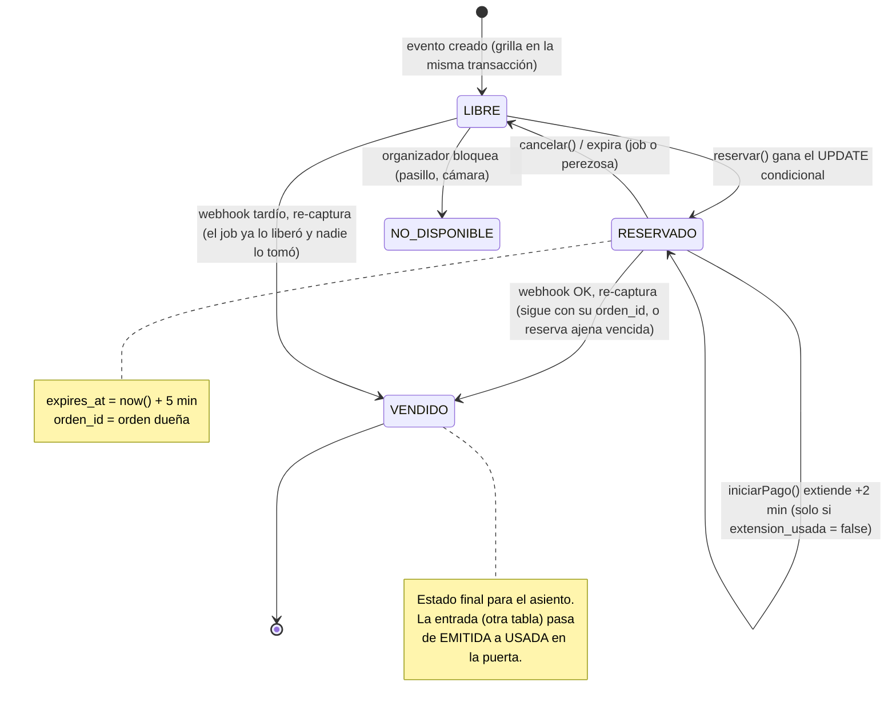
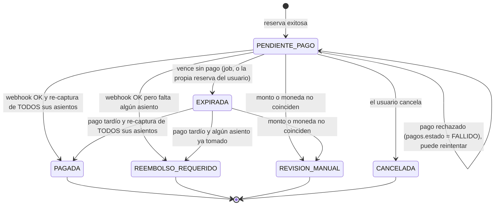
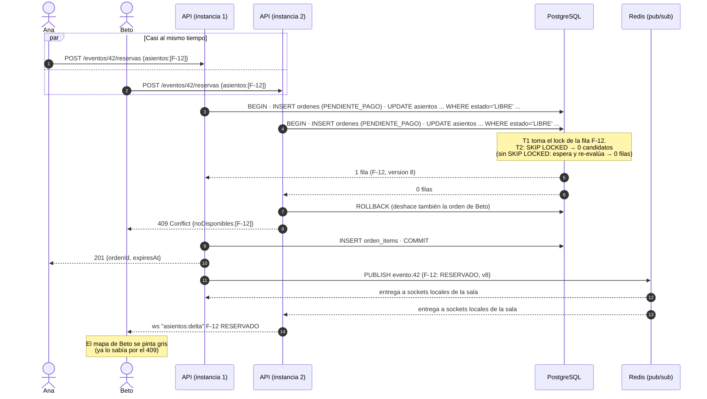
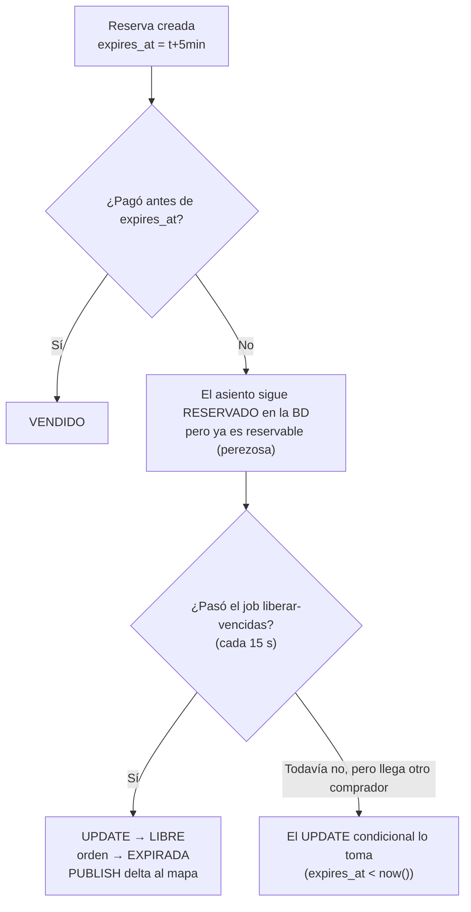

# 04 — Concurrencia y prevención de la doble compra

> **Invariante RN-01:** un asiento de un evento tiene **como máximo una** entrada válida.
> Todo este documento explica cómo lo garantizamos aunque haya miles de peticiones a la vez, varias instancias de la API, reintentos de red y webhooks duplicados.

## 1. Estados del asiento



Y los estados de la **orden**:



> No existe un estado FALLIDA de la orden: un rechazo marca el **pago** (`pagos.estado = FALLIDO`) y la orden sigue PENDIENTE_PAGO hasta su `expires_at`. El comprador puede reintentar con un nuevo intento de pago, **sin** nueva extensión de tiempo. "Re-captura" se define en §4.3.

## 2. El problema, con un ejemplo

Ana (Cochabamba) y Beto (Sacaba) tocan el asiento **Platea F-12** en el mismo milisegundo. Las dos peticiones llegan a **instancias distintas** de la API.

Código ingenuo (**INCORRECTO**):

```text
1. SELECT estado FROM asientos WHERE id = 'F-12'   → 'LIBRE'  (Ana)
2. SELECT estado FROM asientos WHERE id = 'F-12'   → 'LIBRE'  (Beto)
3. UPDATE asientos SET estado='RESERVADO', orden=Ana
4. UPDATE asientos SET estado='RESERVADO', orden=Beto   ← pisa a Ana
```

Es una **condición de carrera** del tipo *check-then-act* (leer, decidir, escribir). Entre la lectura y la escritura, el mundo cambió.

## 3. Opciones para resolverlo

| Opción | Cómo funciona | Pros | Contras | ¿Elegida? |
|---|---|---|---|---|
| **A. UPDATE condicional atómico** ("bloqueo optimista" o *compare-and-set*) | `UPDATE ... WHERE estado='LIBRE'`: la condición y la escritura son **una sola operación** | Simple. Sin locks largos. El perdedor se entera de inmediato (0 filas) | Hay que manejar el "0 filas" | ✅ **Sí** |
| B. Bloqueo pesimista | `SELECT ... FOR UPDATE` y mantener la transacción abierta mientras el usuario decide o paga | Intuitivo | Las transacciones abiertas durante minutos agotan las conexiones. Los usuarios esperan en fila al de adelante. Riesgo de deadlocks | ❌ |
| C. Versión optimista clásica | Leer `version`, luego `UPDATE ... WHERE version = v` | Estándar en ORMs | Igual que A pero con un paso extra. Para un estado simple, A es más directo. (Igual guardamos `version` para el WebSocket) | Parcial |
| D. Lock distribuido en Redis (Redlock) | `SET lock:F-12 NX PX 5000` antes de tocar la BD | Rápido | **Dos fuentes de verdad.** Si el lock expira por una pausa (GC, red) dos procesos creen tenerlo. Si Redis pierde datos, se pierden locks. Igual hace falta la BD | ❌ |
| E. Cola única por evento (serializar) | Todas las reservas de un evento pasan por un solo consumidor | Imposible que haya carrera | Latencia alta, punto único de fallo, y el usuario no recibe la respuesta de inmediato | ❌ |
| F. Restricción única como única defensa | INSERT en `reservas(asiento_id)` UNIQUE y capturar el error | Muy robusto | Funciona, pero la expiración (borrar o reusar filas) se complica | Como **segunda red** |

### ¿Por qué no bloqueo pesimista? (B)

Problema: el comprador tarda de 30 s a 5 min en pagar. Si mantenemos `FOR UPDATE` durante ese tiempo:
- cada comprador ocupa **una conexión de Postgres**. El pooler gratuito de Supabase tiene decenas, no miles;
- el segundo usuario que toca F-12 **queda colgado esperando** en vez de recibir "ocupado" al instante;
- si el servidor se reinicia, Postgres libera el lock... pero el usuario pierde su reserva sin explicación.

El estado `RESERVADO` + `expires_at` es un **"lock lógico" persistido**: dura minutos, sobrevive a reinicios y **no ocupa conexiones**.

> Matiz técnico importante: el UPDATE condicional **sí** toma un lock de fila durante los milisegundos que dura su transacción. Lo que evitamos es mantener locks **mientras el usuario piensa**.

### ¿Por qué no lock distribuido en Redis? (D)

1. **Dos fuentes de verdad:** Redis dice "Ana tiene el lock" y Postgres dice "LIBRE". ¿A quién le creemos si discrepan?
2. **Los locks con TTL no son seguros ante pausas.** El proceso 1 toma el lock (TTL 5 s), sufre una pausa de 6 s (GC, red móvil, VM congelada), el lock expira, el proceso 2 lo toma y **ambos escriben**. Para evitarlo hacen falta *fencing tokens*, que tiene que verificar... la base de datos. Así que terminamos en la opción A igual.
3. **Redis no es durable por defecto.** Con un reinicio se pierden los locks.
4. **No aporta valor:** Postgres ya serializa los UPDATE sobre la misma fila. Añadir Redis solo agrega latencia y fallos posibles.

## 4. La solución elegida, paso a paso

### 4.1 Reservar (todo o nada)

**Paso 0, RN-04 sin depender del job.** El índice único `ordenes(usuario_id, evento_id) WHERE estado='PENDIENTE_PAGO'` impide que un usuario tenga dos órdenes pendientes en el mismo evento. Pero si su orden anterior **ya venció** y el job todavía no la marcó (por ejemplo, con el Worker caído), el índice lo bloquearía igual. Por eso la transacción de reservar empieza marcando EXPIRADA esa orden vencida:

```sql
-- Misma transacción que el resto de la reserva
UPDATE ordenes
SET estado = 'EXPIRADA'
WHERE usuario_id = $usuario
  AND evento_id  = $evento
  AND estado     = 'PENDIENTE_PAGO'
  AND expires_at < now();       -- now() de Postgres
```

No hace falta tocar sus asientos: la expiración perezosa ya los trata como libres, y el job los pasa a LIBRE y publica el delta cuando corra. Si la orden pendiente **no** venció, este UPDATE afecta 0 filas y el INSERT de la orden nueva (paso 1) choca con el índice: **409 `ORDEN_PENDIENTE_EXISTENTE`** (C-07).

**Paso 1, crear la orden primero.** `asientos.orden_id` es una clave foránea **normal** (no diferible) hacia `ordenes(id)`, así que la orden tiene que existir antes de que un asiento apunte a ella:

```sql
INSERT INTO ordenes (id, usuario_id, evento_id, estado, expires_at, extension_usada,
                     idempotency_key, total_centavos, moneda)
VALUES ($orden, $usuario, $evento, 'PENDIENTE_PAGO',
        now() + interval '5 minutes', false, $idempotencyKey,
        (SELECT sum(z.precio_centavos)                 -- precio de cada zona al reservar (RN-05)
           FROM asientos a JOIN zonas z ON z.id = a.zona_id
          WHERE a.evento_id = $evento AND a.id = ANY($ids)),
        'BOB');
```

- Si choca con el índice de RN-04: ROLLBACK y **409 `ORDEN_PENDIENTE_EXISTENTE`**, sin haber tocado ningún asiento.
- Si choca con `UNIQUE(usuario_id, idempotency_key)`: es un reintento. ROLLBACK y se devuelve la orden que ya existe (**201** con el mismo `ordenId`, C-06).

**Paso 2, tomar los asientos:**

```sql
-- Misma transacción (READ COMMITTED, el nivel por defecto de Postgres)
WITH candidatos AS (
  SELECT id
  FROM asientos
  WHERE evento_id = $evento
    AND id = ANY($ids)                       -- máx. 6 asientos
    AND (
          estado = 'LIBRE'
       OR (estado = 'RESERVADO' AND expires_at < now())   -- expiración perezosa
    )
  ORDER BY id                                -- orden fijo ⇒ sin deadlocks
  FOR UPDATE SKIP LOCKED                     -- si otro lo está tocando, no esperar
)
UPDATE asientos a
SET estado     = 'RESERVADO',
    orden_id   = $orden,
    expires_at = now() + interval '5 minutes',
    version    = a.version + 1
FROM candidatos c
WHERE a.id = c.id
RETURNING a.id, a.version;
```

**Paso 3, confirmar o deshacer todo:**
- Si `RETURNING` devuelve **tantas filas como asientos pedidos**: `INSERT orden_items` (con el precio congelado de cada asiento), `COMMIT` y **201**.
- Si devuelve **menos**: **ROLLBACK de toda la transacción**. Se deshacen el UPDATE de los asientos que sí se tomaron, el INSERT de la orden (paso 1) y el paso 0. Respuesta **409 Conflict** con la lista de asientos no disponibles. Así se cumple el *todo o nada* (RN-03) y nunca queda una orden sin asientos.
- `now()` devuelve la hora de **inicio de la transacción**, así que `ordenes.expires_at` y `asientos.expires_at` quedan exactamente iguales aunque se escriban en sentencias distintas.

**Regla de orden de bloqueo (reservas y re-capturas).** Toda sentencia que bloquea varios asientos lo hace en un **orden fijo, `ORDER BY id`**: la reserva (aquí), la re-captura y la liberación del webhook (§4.3), la extensión (§4.4) y el job de expiración (§6). Un *deadlock* necesita un ciclo: T1 tiene el asiento 1 y espera el 3, mientras T2 tiene el 3 y espera el 1. Si todos piden los locks de menor a mayor, ese ciclo no se puede formar. Ejemplo: una reserva pide {3, 2, 1} y, al mismo tiempo, la re-captura de una orden vencida pide {1, 2, 3}. Las dos piden primero el 1. La reserva, con `SKIP LOCKED`, ni siquiera espera. La re-captura espera unos milisegundos, pero nunca en un ciclo. Lo verifica el test C-09.

**Por qué cada parte:**
| Fragmento | Para qué |
|---|---|
| `estado='LIBRE' OR (... expires_at < now())` | **Expiración perezosa:** una reserva vencida se trata como libre **aunque el job aún no haya pasado**. La correctitud no depende del job |
| `ORDER BY id ... FOR UPDATE` | Dos órdenes que piden {F-12, F-13} y {F-13, F-12} toman los locks en el **mismo orden**, así que no puede haber *deadlock* (ver la regla de orden de bloqueo, abajo) |
| `SKIP LOCKED` | Si otra transacción está reservando F-12 en ese instante, no esperamos: F-12 queda fuera de los candidatos y respondemos 409 al instante |
| `version + 1` | El WebSocket envía la versión. El cliente descarta mensajes viejos que lleguen desordenados |

#### Versión mínima (un solo asiento), para entender la idea

```sql
UPDATE asientos
SET estado='RESERVADO', orden_id=$orden, expires_at=now()+interval '5 minutes'
WHERE id=$asiento AND (estado='LIBRE' OR (estado='RESERVADO' AND expires_at<now()))
RETURNING id;
```

¿Qué pasa con 2 transacciones simultáneas en READ COMMITTED?
1. T1 encuentra la fila LIBRE, la bloquea y la actualiza (todavía sin commit).
2. T2 encuentra la misma fila y **espera** el lock de T1 (milisegundos).
3. T1 hace COMMIT.
4. Postgres **re-evalúa el WHERE de T2** sobre la versión nueva de la fila: `estado='RESERVADO'` y `expires_at` está en el futuro, así que la condición es falsa y T2 actualiza **0 filas**.

Esta re-evaluación es la clave: el `WHERE` y el `SET` se comportan como **una sola operación atómica** sobre esa fila.

### 4.2 Segunda red de seguridad: restricciones en la BD

Aunque el código tuviera un bug, la base de datos impide el estado inválido:

```sql
-- Un asiento existe una vez por evento
UNIQUE (evento_id, fila, columna)

-- Una sola entrada válida por asiento (índice único parcial)
CREATE UNIQUE INDEX ux_entrada_valida_por_asiento
  ON entradas (asiento_id) WHERE estado IN ('EMITIDA','USADA');

-- Coherencia entre estado, orden y vencimiento
CHECK (
     (estado = 'RESERVADO'                 AND orden_id IS NOT NULL AND expires_at IS NOT NULL)
  OR (estado = 'VENDIDO'                   AND orden_id IS NOT NULL AND expires_at IS NULL)
  OR (estado IN ('LIBRE','NO_DISPONIBLE')  AND orden_id IS NULL     AND expires_at IS NULL)
)
```

> Nota sobre `SKIP LOCKED`: si la transacción que tenía bloqueada la fila termina en ROLLBACK, el segundo usuario recibió un 409 que en teoría no correspondía. Lo aceptamos: es raro, dura milisegundos y el usuario ve el asiento libre de nuevo en el mapa. A cambio, nadie se queda esperando un lock.

Así, la invariante RN-01 queda garantizada **por la base de datos**, no solo por nuestro código. Esto es *defensa en profundidad*.

### 4.3 Confirmar el pago (webhook) y re-captura

**Re-captura** = volver a tomar, con una actualización condicional y **todo o nada**, los asientos de la orden (los de `orden_items`) en el momento en que llega el pago. Un asiento se puede re-capturar si:
- sigue `RESERVADO` con **nuestro** `orden_id`, aunque la reserva haya vencido;
- está `LIBRE` (venció, el job lo liberó y nadie lo tomó);
- está `RESERVADO` por **otra** orden cuya reserva ya venció (la misma regla de la expiración perezosa).

```sql
-- Dentro de la transacción del webhook (ver doc 05 para la idempotencia)
SAVEPOINT recaptura;

WITH candidatos AS (
  SELECT a.id
  FROM asientos a
  JOIN orden_items oi ON oi.asiento_id = a.id AND oi.orden_id = $orden
  WHERE (a.estado = 'RESERVADO' AND a.orden_id = $orden)        -- sigue siendo nuestro
     OR  a.estado = 'LIBRE'                                       -- liberado y libre
     OR (a.estado = 'RESERVADO' AND a.expires_at < now())         -- reserva ajena vencida
  ORDER BY a.id
  FOR UPDATE                    -- sin SKIP LOCKED: aquí conviene esperar unos ms y re-evaluar
)
UPDATE asientos a
SET estado = 'VENDIDO', orden_id = $orden, expires_at = NULL, version = a.version + 1
FROM candidatos c
WHERE a.id = c.id
RETURNING a.id;
```

- **Consiguió todos** (filas devueltas = filas de `orden_items`): `UPDATE ordenes SET estado='PAGADA' WHERE id=$orden AND estado IN ('PENDIENTE_PAGO','EXPIRADA')`, pago CONFIRMADO, `INSERT entradas` (una por asiento) e `INSERT outbox (ENTRADAS_EMITIDAS)` → COMMIT.
- **Faltó alguno** (otra orden lo tiene con reserva vigente, o ya está VENDIDO): `ROLLBACK TO SAVEPOINT recaptura`, así ningún asiento queda VENDIDO a medias. Después, en la misma transacción: orden **REEMBOLSO_REQUERIDO**, pago CONFIRMADO (el dinero sí llegó), se liberan los asientos que todavía eran nuestros (`WHERE orden_id=$orden AND estado='RESERVADO'`) e `INSERT outbox (REEMBOLSO_REQUERIDO)` (email de disculpa) → COMMIT. **Nunca** se emite una entrada duplicada.
- El `SAVEPOINT` es necesario porque la fila de `webhook_eventos` insertada al inicio **debe** confirmarse en ambos casos: si no, el reintento del proveedor volvería a procesar el evento.
- **Sin SKIP LOCKED:** si otra transacción está reservando uno de esos asientos justo ahora, saltarlo daría un REEMBOLSO_REQUERIDO falso. Esperar unos milisegundos es aceptable en un webhook. Postgres re-evalúa el WHERE tras la espera.
- **Mismo orden de bloqueo que la reserva (`ORDER BY a.id`).** Como la re-captura sí espera, el orden fijo es lo que impide un *deadlock*: frente a una reserva que pide los mismos asientos en otro orden, o frente a la re-captura de **otra** orden que comparte asientos (por ejemplo, dos webhooks tardíos de órdenes que vencieron sobre los mismos asientos). La liberación del caso REEMBOLSO_REQUERIDO bloquea con el mismo patrón (`SELECT … WHERE orden_id=$orden AND estado='RESERVADO' ORDER BY id FOR UPDATE`). Ver la regla en §4.1 y el test C-09.
- **Pago rechazado** (`pago.fallido`): no toca asientos ni orden. Solo `UPDATE pagos SET estado='FALLIDO' WHERE id=$pago AND estado='EN_PROCESO'`. La orden sigue PENDIENTE_PAGO hasta su `expires_at` y el comprador puede reintentar. Como el UPDATE exige `EN_PROCESO`, un `FALLIDO` que llega **después** de un `EXITOSO` no revierte nada (doc 05 §4).

### 4.4 Extender la reserva al iniciar el pago (+2 min, una vez)

`ordenes.expires_at` y `asientos.expires_at` deben moverse **juntos**: la reserva usa el de los asientos y el job usa el de la orden. Por eso se extienden en la **misma transacción**, y `extension_usada = false` garantiza que pase una sola vez, aunque el comprador toque "Pagar" dos veces o reintente tras un rechazo:

```sql
WITH o AS (
  UPDATE ordenes
  SET expires_at = expires_at + interval '2 minutes',
      extension_usada = true
  WHERE id = $orden
    AND estado = 'PENDIENTE_PAGO'
    AND extension_usada = false
    AND expires_at > now()          -- una reserva ya vencida no se revive
  RETURNING id, expires_at
),
s AS (
  SELECT a.id
  FROM asientos a JOIN o ON a.orden_id = o.id
  WHERE a.estado = 'RESERVADO'
  ORDER BY a.id                     -- mismo orden de bloqueo que reservar y re-capturar
  FOR UPDATE OF a
)
UPDATE asientos a
SET expires_at = o.expires_at
FROM s, o
WHERE a.id = s.id;
```

Si el primer UPDATE afecta 0 filas (extensión ya usada), el pago sigue con el vencimiento actual. No hace falta incrementar `version`: el vencimiento no se muestra en el mapa.

## 5. Diagrama de secuencia: dos usuarios, un asiento



> Importante: **primero COMMIT, después PUBLISH.** Si publicáramos antes del commit y la transacción fallara, los clientes verían un estado que nunca existió. Si el PUBLISH falla después del commit, no pasa nada grave: el cliente se resincroniza (ver doc 05, §3).

## 6. Expiración de la reserva



Job `liberar-vencidas` (en el Worker, repetible cada 15 s):

```sql
WITH vencidos AS (
  SELECT id FROM asientos
  WHERE estado='RESERVADO' AND expires_at < now()
  ORDER BY id
  LIMIT 500
  FOR UPDATE SKIP LOCKED
)
UPDATE asientos a SET estado='LIBRE', orden_id=NULL, expires_at=NULL, version=a.version+1
FROM vencidos v WHERE a.id=v.id
RETURNING a.id, a.evento_id, a.version;
-- luego: UPDATE ordenes SET estado='EXPIRADA' WHERE estado='PENDIENTE_PAGO' AND expires_at < now()
-- luego: PUBLISH deltas por evento
```

- **`SKIP LOCKED` + `LIMIT`**: si hay 2 Workers no procesan la misma fila, y un lote grande no bloquea la tabla.
- **Si el Worker está caído:** los asientos vencidos se ven como RESERVADO en el mapa (dato visual algo desactualizado), pero **se pueden reservar** igual, gracias a la expiración perezosa. Además, el endpoint del mapa calcula `estado_efectivo` con la misma regla, así que **incluso el mapa se ve bien**:
  ```sql
  CASE WHEN estado='RESERVADO' AND expires_at < now() THEN 'LIBRE' ELSE estado END
  ```
- **Relojes:** todas las comparaciones usan `now()` **de Postgres**, nunca la hora del servidor de la API. Así se evitan errores por relojes desincronizados entre máquinas (*clock skew*). El contador del navegador es solo visual y se calcula a partir del `expiresAt` que envía el servidor.

## 7. ¿Qué pasa si falla cada paso?

| # | Falla | Qué ve el usuario | Estado del sistema | Por qué es seguro |
|---|---|---|---|---|
| 1 | La petición de reserva se pierde en la red móvil **antes** de llegar | Spinner, luego error. Reintenta | Nada cambió | — |
| 2 | La reserva se hizo, pero la **respuesta** se perdió | Error. Al reintentar recibe 409... ¡por su propio asiento! | Orden PENDIENTE_PAGO del mismo usuario | La petición lleva `Idempotency-Key` (UUID generado por el cliente). Un reintento con la misma clave **devuelve la orden existente** (201) en vez de 409. Además RN-04 (una orden pendiente por evento) permite mostrarle "Ya tienes una reserva" |
| 3 | La API se cae **durante** la transacción de reserva | Error | Postgres hace ROLLBACK automático | Atomicidad |
| 4 | La API se cae **después** del COMMIT y antes de PUBLISH | Su reserva existe y los demás no la ven en vivo | El mapa de los demás queda desactualizado hasta el próximo delta o resync | Si otro intenta reservar ese asiento, recibe 409. La BD decide, no el mapa |
| 5 | Redis cae | La reserva funciona. El mapa en vivo se congela y los clientes pasan a polling REST | Rate limiting en modo degradado (memoria local) | Redis no participa en la decisión |
| 6 | El usuario cierra la pestaña sin pagar | — | La reserva vence a los 5 min | Expiración perezosa + job |
| 7 | El usuario paga pero el **webhook** tarda 10 min | "Procesando pago..." | Puede vencer la reserva | Re-captura (§4.3): si se consiguen **todos** los asientos de la orden, se vende. Si falta alguno: REEMBOLSO_REQUERIDO, sin ventas parciales |
| 8 | Llega el **webhook duplicado** | — | — | `UNIQUE(proveedor, evento_externo_id)` (doc 05) |
| 9 | El Worker cae al emitir el PDF | La entrada aparece en "Mis entradas". El email llega más tarde | Job en Redis (o fila en outbox) | Reintento al volver |
| 10 | El reloj de una instancia de la API está adelantado 2 min | Nada | Nada | Solo usamos `now()` de Postgres |
| 11 | Un bug en el código intenta emitir 2 entradas del mismo asiento | Error 500 en un caso límite | El INSERT falla | Índice único parcial `ux_entrada_valida_por_asiento` |
| 12 | Dos validadores escanean la misma entrada a la vez | Uno ve VÁLIDA y el otro YA USADA | Una fila USADA | Mismo patrón: `UPDATE entradas SET estado='USADA' WHERE id=$1 AND estado='EMITIDA'` |

## 8. Qué probamos con TDD (adelanto del doc 10)

1. 50 reservas concurrentes del mismo asiento ⇒ exactamente 1 éxito.
2. 2 órdenes con asientos solapados {1,2,3} y {3,4,5} ⇒ una gana todo y la otra recibe 409, sin reservas parciales.
3. 2 órdenes con asientos en orden inverso ⇒ ningún deadlock (timeout del test: 5 s).
4. Una reserva vencida (reloj de BD manipulado con `expires_at` en el pasado) ⇒ otra orden puede reservar sin que corra el job.
5. El job de expiración con 2 instancias en paralelo ⇒ cada asiento se libera una vez.
6. Validación doble concurrente ⇒ una VÁLIDA y una YA_USADA.
7. Una orden pendiente **vencida** del mismo usuario (sin que corra el job) no bloquea una nueva reserva en ese evento (C-08).
8. Reserva y re-captura concurrentes sobre los mismos asientos en orden inverso ⇒ ningún deadlock (C-09).
