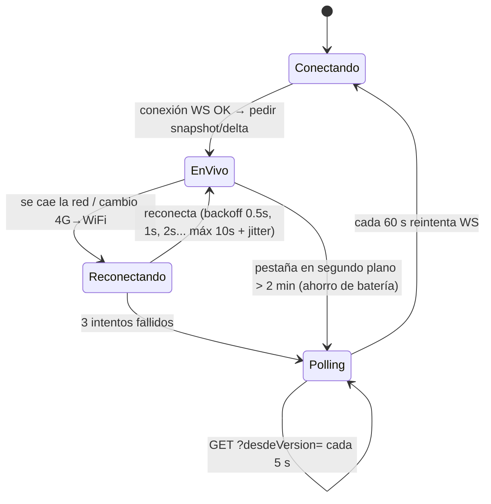
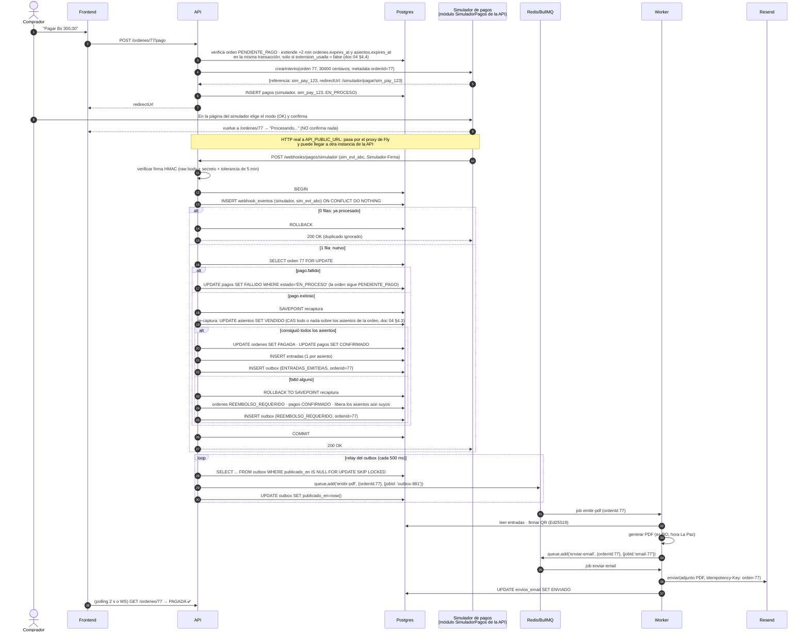
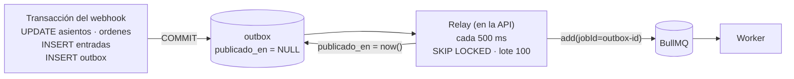

# 05 — Comunicación, idempotencia y pagos

## 1. Tres canales, cada uno para lo que sirve

| Canal | Se usa para | Por qué este canal |
|---|---|---|
| **REST (HTTPS + JSON)** | Login, catálogo, reservar, pagar, mis entradas, validar QR, panel del organizador | Petición-respuesta simple, cacheable (catálogo), fácil de probar con curl, y los códigos HTTP expresan bien el resultado (201, 409, 429) |
| **WebSocket (Socket.IO)** | **Solo** el estado de los asientos en vivo (servidor → cliente) | Empuja cambios sin que el cliente pregunte. Con polling a 1 s, 5.000 usuarios harían 5.000 req/s solo para "¿cambió algo?" |
| **Cola (BullMQ sobre Redis)** | Generar QR + PDF, enviar el email y el job de expiración | Trabajo lento o frágil que **no** debe bloquear al comprador y que necesita reintentos |

**Regla de oro:** el WebSocket **solo informa**, nunca decide. Para reservar siempre se usa `POST /reservas` (REST). Así las acciones importantes tienen respuesta, código de error e `Idempotency-Key`, y el WS se puede perder sin consecuencias.

### ¿Por qué no GraphQL?

- **Problema:** ¿necesitamos un lenguaje de consulta flexible?
- **Opciones:** REST, GraphQL, gRPC.
- **Elección:** REST.
- **Por qué:**
  - Tenemos **pocos endpoints fijos** (≈20). GraphQL rinde cuando hay muchos clientes con necesidades de datos distintas, y nosotros tenemos uno.
  - El **caché HTTP** del catálogo (CDN, `Cache-Control`) es trivial en REST y difícil en GraphQL (todo es `POST /graphql`).
  - El **rate limiting por endpoint** (p. ej. `/reservas`) es directo en REST. En GraphQL habría que analizar la consulta.
  - Las **suscripciones GraphQL** usan WebSocket por debajo. No resuelven el escalado: tendríamos el mismo problema con una capa más encima.
  - Curva de aprendizaje: 6 semanas.
  - gRPC no corre nativamente en el navegador y no tenemos comunicación entre servicios.

## 2. Contrato REST (resumen)

| Método y ruta | Rol | Respuestas clave |
|---|---|---|
| `POST /auth/registro` · `POST /auth/login` | público | 201 / 200 `{token}` · 400 (validación) · 409 en el registro · 401 en el login |
| `GET /ciudades` | público | 200 |
| `GET /eventos?ciudad=cochabamba&estado=PUBLICADO&pagina=1&porPagina=20` | público | 200 `{items, pagina, porPagina, total}` (cache 30 s). `estado` admite PUBLICADO (por defecto), FINALIZADO o CANCELADO; BORRADOR → 400 |
| `GET /eventos/:id` | público | 200 |
| `GET /eventos/:id/asientos` | público | 200 `{eventoId, version, zonas:[...], asientos:[...]}` (snapshot) · 404 si no existe **o es BORRADOR** (mismo mensaje) |
| `GET /eventos/:id/asientos?desdeVersion=812` | público | 200 `{version, cambios:[...]}` (delta para polling) |
| `POST /eventos/:id/reservas` + `Idempotency-Key` | comprador | 201 `{ordenId, expiresAt, totalCentavos}` · **409** `{noDisponibles}` · 429 |
| `DELETE /ordenes/:id` | comprador (dueño) | 204 |
| `POST /ordenes/:id/pago` | comprador (dueño) | 200 `{proveedor, redirectUrl \| clientSecret}` |
| `POST /webhooks/pagos/:proveedor` | proveedor (firma) | **200** siempre que la firma sea válida (incluso si es duplicado) · 400 si la firma es inválida |
| `GET /mis-entradas` · `GET /entradas/:id/pdf` | comprador | 200 |
| `POST /validaciones` `{qr}` | validador | 200 `{resultado: VALIDA \| YA_USADA \| INVALIDA \| OTRO_EVENTO, usadaEn?}` |
| `POST /eventos` | organizador o admin | 201: evento BORRADOR + zona + grilla de asientos LIBRE, en una transacción · 400 (validación, recinto inexistente, grilla > 15.000 asientos) · 403 (un organizador a nombre de otro) |

**Auth y enumeración de usuarios (T9):**
- **Login:** responde lo mismo, `401 {"message": "Email o contraseña incorrectos"}`, cuando el email no existe y cuando la contraseña está mal. Si el email no existe, se verifica igual contra un hash señuelo de argon2id, para que el tiempo de respuesta no delate qué emails están registrados.
- **Registro:** si el email ya existe responde `409 {"message": "No se pudo completar el registro"}`, sin decir qué campo chocó. **Limitación aceptada:** el 409 igual revela que el email está registrado. Evitarlo exige verificar el email (responder siempre «te enviamos un correo»), y eso está fuera de alcance. Lo mitiga el rate limit por IP (A-07).
- **Guards:** cualquier JWT inválido (vencido, firma alterada, `alg: none`, mal formado) da el mismo `401 {"message": "No autenticado"}`. Un rol sin permiso da `403`. Todo endpoint exige JWT salvo los marcados con `@Publico()`.

**Formato de dinero:** siempre `{"totalCentavos": 30000, "moneda": "BOB"}`. El frontend formatea `Bs 300,00` con `Intl.NumberFormat('es-BO', {style:'currency', currency:'BOB'})`.
**Formato de fecha:** ISO 8601 en UTC (`2026-11-22T01:00:00Z`). El frontend lo muestra en `America/La_Paz` ("sáb. 21 nov., 21:00").

## 3. WebSocket: protocolo del mapa en vivo

```text
cliente → servidor   "evento:unirse"   {eventoId: 42}
servidor → cliente   "asientos:snapshot" {version: 812, asientos: <compacto>}
servidor → cliente   "asientos:delta"  {desde: 812, hasta: 815, cambios:[{id, estado, v}]}
```

### Versionado y resincronización

- Cada evento tiene un contador `mapa_version`, que se incrementa con cada cambio de asiento.
- El cliente guarda `versionLocal`. Si llega un delta con `desde > versionLocal`, **le falta algo** (se perdió un mensaje), así que pide `GET /asientos?desdeVersion=versionLocal`, o el snapshot completo si la diferencia es grande.
- Así toleramos mensajes **perdidos, duplicados o desordenados** (*consistencia eventual* del cliente).

### Reconexión y respaldo con polling (redes móviles)



- Socket.IO trae reconexión automática con backoff exponencial y *jitter*. El *jitter* (aleatoriedad) evita que 5.000 celulares reconecten **en el mismo milisegundo** tras un microcorte (efecto *thundering herd*).
- Transporte: `transports: ['websocket']`. **No** usamos el long-polling de Socket.IO porque, con varias instancias, exige *sticky sessions*. El respaldo es **nuestro polling REST**, que no tiene estado y funciona con cualquier instancia.
- Tras **cada** reconexión, el cliente pide el delta desde su versión: durante el corte pudo perderse cambios.

### Formato compacto del snapshot

15.000 asientos × `{"id":"...","fila":"F","col":12,"estado":"LIBRE"}` ≈ 900 KB. Inviable en 4G.
**Solución:** la geometría (filas, columnas, zonas) es **estática**, se descarga una vez y se cachea en la CDN. El estado se envía como una cadena con **1 carácter por asiento** en orden fijo (`L`, `R`, `V`, `X`): 15.000 bytes ≈ **3–4 KB con gzip**.

## 4. Flujo completo del pago y el webhook



> **Variante opcional con Stripe test:** la secuencia es la misma. Solo cambian el participante (Stripe Checkout en lugar de la página del simulador), la referencia (`pi_…`), el evento (`evt_…`), la firma (`Stripe-Signature`) y la ruta: `POST /webhooks/pagos/stripe`. Desde `verificarYNormalizar` en adelante, `PagosService` ejecuta exactamente los mismos pasos.

### Detalles que importan

1. **El navegador nunca confirma un pago.** La URL de retorno puede ser falsificada, o el usuario puede cerrar la pestaña. **Solo el webhook firmado** confirma.
2. **Raw body:** la firma del proveedor se calcula sobre el cuerpo **exacto** en bytes (en el simulador, la cabecera propia `Simulador-Firma` con HMAC-SHA256; en la variante opcional con Stripe, `Stripe-Signature`). NestJS debe habilitar `rawBody: true` para esa ruta. Si el JSON se parsea y se vuelve a serializar, la firma no coincide.
3. **Responder 200 al duplicado.** Si respondiéramos 4xx/5xx, el proveedor **seguiría reintentando**.
4. **Responder rápido.** El proveedor espera una respuesta en pocos segundos (el simulador, igual que Stripe, reintenta si no recibe un 2xx). Por eso la transacción del webhook solo hace escrituras en la BD, y el PDF y el email van por la cola.
5. **Verificar el monto.** Si `evento.monto != orden.totalCentavos` o la moneda no coincide: no se emiten entradas, la orden pasa a `REVISION_MANUAL` y se genera una alerta.
6. **Orden de llegada:** un `payment_failed` puede llegar **después** de un `succeeded` (reintentos del proveedor). Regla: una orden PAGADA **no retrocede** por un evento posterior de fallo.

## 5. Idempotencia en cada capa

**Idempotente** = repetir la operación produce el mismo efecto que hacerla una vez.

| Capa | Riesgo de duplicado | Mecanismo |
|---|---|---|
| Cliente → `POST /reservas` | El usuario toca dos veces, o la red reintenta | Header `Idempotency-Key` (UUID v4 del cliente) guardado con la orden: `UNIQUE(usuario_id, idempotency_key)`. Repetir devuelve la misma respuesta |
| Proveedor → webhook | El proveedor reintenta, o el simulador envía a propósito 2–5 veces | `webhook_eventos UNIQUE(proveedor, evento_externo_id)` dentro de la **misma transacción** que emite las entradas |
| Mismo pago con eventos distintos | Dos eventos diferentes (`checkout.session.completed` y `payment_intent.succeeded`) por el mismo cobro | `pagos UNIQUE(proveedor, referencia_externa)` + la orden solo pasa de PENDIENTE a PAGADA una vez (`UPDATE ... WHERE estado IN ('PENDIENTE_PAGO','EXPIRADA')`) |
| Emisión de entradas | Bug o carrera | Índice único parcial por asiento (doc 04) |
| Outbox → cola | El relay publica, cae antes de marcar `publicado_en` y vuelve a publicar | `jobId = 'outbox-<id>'`: BullMQ **ignora** un job con un `jobId` que ya existe |
| Worker → email | El job envía el email y el Worker cae antes de marcarlo como completado, así que BullMQ lo reintenta | Tabla `envios_email UNIQUE(orden_id, tipo)` con estado + `Idempotency-Key` hacia Resend (si el proveedor lo soporta: verificar en su documentación actual). **Sin garantía absoluta:** un email duplicado es un riesgo aceptado y documentado (no hace daño, la entrada es la misma) |
| Validador → `POST /validaciones` | Doble escaneo | `UPDATE ... WHERE estado='EMITIDA'` (doc 04) |

### Al-menos-una-vez + idempotencia = "efectivamente una vez"

Las colas y los webhooks garantizan **al menos una** entrega. "Exactamente una vez" en la red no existe en general. Lo que sí podemos lograr es que **el efecto** ocurra una vez: el mensaje llega 1..N veces, y el consumidor idempotente lo aplica una.

## 6. Outbox transaccional

**Problema (doble escritura):** al confirmar el pago hay que (a) guardar en Postgres y (b) encolar en Redis. No existe una transacción que abarque ambos.
- Si encolamos antes del COMMIT y el COMMIT falla, se envía un email de una entrada que no existe.
- Si encolamos después del COMMIT y la API cae justo entre los dos pasos, se pagó y **nunca** se envía el email.

**Opciones:** 1) aceptar el riesgo · 2) outbox · 3) CDC (Debezium leyendo el WAL) · 4) que el Worker escanee tablas buscando trabajo pendiente.

**Elección:** **outbox** (con polling).
**Por qué:** dentro de la misma transacción se inserta una fila `outbox`. Si hay COMMIT, la intención de encolar es **durable**, y un *relay* la publica después (al menos una vez). CDC sería más eficiente pero exige infraestructura que **no aporta valor** a esta escala.



Si Redis está caído, el relay falla, la fila sigue con `publicado_en = NULL` y se reintenta en el próximo ciclo. **La venta no se detiene.**

## 7. Reintentos, backoff y cola de fallidos

| Job | Intentos | Backoff | Al agotarse |
|---|---|---|---|
| `emitir-pdf` | 5 | exponencial 5 s, 10 s, 20 s, 40 s, 80 s | Queda en *failed*. Alerta en logs. Botón "reintentar" en Bull Board |
| `enviar-email` | 8 | exponencial 30 s ... (≈ 2 h en total) | *failed* + `envios_email.estado = FALLIDO`. Visible para el organizador |
| `liberar-vencidas` | repetible cada 15 s | — | Si falla una vez, la siguiente corrida lo cubre (y la expiración perezosa protege igual) |

**Errores transitorios vs. permanentes:** un `503` de Resend o un timeout se **reintentan**. Un email inválido (`422`) **no se reintenta**: se marca FALLIDO de inmediato. Reintentar un error permanente solo gasta la cuota (100 emails/día en el plan gratis).

## 8. Pagos detrás de un puerto (Adapter + Strategy)

**Problema:** Stripe no sirve en producción en Bolivia, y el proveedor real (QR bancario) todavía no existe para nosotros. No queremos reescribir Órdenes cuando cambie el proveedor.

**Elección:** un **puerto** (interfaz) en el dominio y un **adaptador** por proveedor. Qué adaptadores existen y cuál se usa lo decide la configuración: `PAYMENT_PROVIDERS=simulador,stripe` registra los habilitados y `PAYMENT_PROVIDER_DEFAULT=simulador` elige el de los pagos nuevos (valores posibles: `simulador|stripe|qr`). Los webhooks se enrutan por `:proveedor` (`POST /webhooks/pagos/simulador`, `/webhooks/pagos/stripe`): el controlador elige el adaptador de ese proveedor para verificar la firma, aunque el pago se haya creado cuando el proveedor por defecto era otro. Eso es el patrón Strategy. La API no arranca si `PAYMENT_PROVIDER_DEFAULT` no está en `PAYMENT_PROVIDERS`.

```mermaid
classDiagram
    class ProveedorPago {
        <<interface>>
        +nombre: string
        +umbralReconciliacion: duración
        +crearIntento(orden: OrdenParaPago) IntentoPago
        +verificarYNormalizar(headers, rawBody) EventoPagoNormalizado
        +consultarEstado(referencia) EstadoPago
    }
    class EventoPagoNormalizado {
        proveedor: string
        eventoExternoId: string
        referenciaExterna: string
        ordenId: string
        tipo: EXITOSO | FALLIDO
        montoCentavos: bigint
        moneda: "BOB"
    }
    class SimuladorAdapter {
        página propia de "pago"
        firma HMAC-SHA256 de t.rawBody
        estado en tabla simulador_pagos
        modos: OK, RECHAZO, DUPLICAR x N, DEMORA s, DESORDEN
    }
    class StripeTestAdapter {
        <<opcional>>
        (opcional) solo si se abre la cuenta de test
        Checkout Session (modo test)
        verifica Stripe-Signature
    }
    class QrBancarioAdapter {
        <<futuro>>
        (futuro)
        genera QR dinámico vía API bancaria
        callback/consulta del banco
    }
    ProveedorPago <|.. SimuladorAdapter
    ProveedorPago <|.. StripeTestAdapter
    ProveedorPago <|.. QrBancarioAdapter
    class PagosService {
        +iniciarPago(ordenId)
        +procesarWebhook(proveedor, headers, rawBody)
    }
    PagosService --> ProveedorPago : usa
```

- `PagosService.procesarWebhook` **no sabe** de Stripe: recibe un `EventoPagoNormalizado` y aplica las reglas (idempotencia, asientos, entradas, outbox). **Las reglas se prueban una vez** y valen para todos los proveedores.
- **SimuladorAdapter + módulo `SimuladorPagos`** (proveedor principal, ADR-0015). Es un módulo del backend que se comporta como un proveedor externo:
  - **Página de pago propia:** `crearIntento` devuelve `redirectUrl = /simulador/pagar/<referencia>`, donde el comprador elige el modo y confirma.
  - **Firma:** cabecera `Simulador-Firma: t=<ts>,v1=<hex>`, con `v1 = HMAC-SHA256(SIMULADOR_WEBHOOK_SECRET, "<ts>.<rawBody>")`. La API la compara en tiempo constante y rechaza (400) si `t` tiene más de **5 min** de diferencia con su reloj (contra la repetición de webhooks viejos).
  - **Entrega por HTTP real** a `API_PUBLIC_URL + /webhooks/pagos/simulador`: pasa por el proxy y puede llegar a otra instancia.
  - **Reintentos de entrega** con backoff (5 s, 30 s, 2 min, 10 min) mientras la API no responda 2xx, como un proveedor real.
  - **Estado en la tabla `simulador_pagos`**, no en memoria: con 2 instancias, la página de pago, la confirmación y `consultarEstado` pueden caer en instancias distintas. Los envíos pendientes (incluida la `DEMORA`) se guardan con `enviar_en`, y los despacha un tick del propio módulo cada 1 s con `FOR UPDATE SKIP LOCKED`. **No depende del Worker:** con el Worker caído se puede seguir pagando.
  - **`consultarEstado`:** `GET /simulador/pagos/:referencia`.
  - **Modos** para inyectar fallos de forma determinista:
    - `?modo=duplicar&veces=5`: envía el mismo webhook 5 veces en paralelo;
    - `?modo=demora&s=400`: el webhook llega después de que venció la reserva;
    - `?modo=desorden`: llega `FALLIDO` después de `EXITOSO`;
    - `?modo=rechazo`: pago rechazado;
    - `?modo=monto_erroneo`: el monto no coincide con la orden (P-06).
- **`umbralReconciliacion` por proveedor:** cada adaptador declara cuánto esperar antes de preguntar por un pago EN_PROCESO, porque cada proveedor confirma a ritmos distintos. Valores iniciales: simulador **10 min** (mayor que la `DEMORA` más larga de la demo, para no adelantarse al webhook), Stripe **10 min**, QR bancario **1 min** (doc 13). `pagos.actualizado_en` registra la última consulta o cambio de estado.
- **QrBancarioAdapter (futuro):** genera un QR **dinámico** con monto y referencia. La confirmación llega por *callback* del banco o por consulta periódica (`consultarEstado`). El job de reconciliación usa `consultarEstado` para los pagos EN_PROCESO cuyo `pagos.creado_en` supera el **`umbralReconciliacion` del adaptador**, por si se perdió un callback. Detalle en `13-pagos-en-bolivia.md`.

## 9. Validación en puerta (y por qué el QR usa Ed25519)

- Contenido del QR: `TKT1.<base64url(payload)>.<base64url(firma)>`, con payload `{"t":"<uuid entrada>","e":42,"i":1732237200}`. **Sin datos personales.**
- Firma **Ed25519** (asimétrica): solo el Worker tiene la **clave privada**. La API (y en el futuro la app del validador) solo necesitan la **pública**.
  - Ventaja frente a HMAC: un validador con la clave pública podría verificar la autenticidad **sin conexión**, algo útil en recintos con mala señal. Con HMAC, quien verifica también podría **firmar** (falsificar).
- La firma demuestra que **la entrada es auténtica**. La marca USADA (que no se use dos veces) exige consultar la BD **en línea**. El modo offline (lista local + sincronización posterior + resolución de conflictos) queda como mejora futura.
