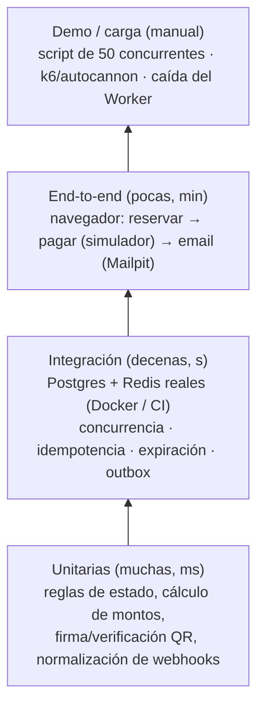

# 10 — Pruebas y demo

## 1. Estrategia

**TDD obligatorio** en concurrencia e idempotencia: el test se escribe **antes** que la implementación y debe fallar primero. Ejemplo: escribir el test de "50 → 1" contra una implementación ingenua (`SELECT` y luego `UPDATE`), ver que **falla** (gana más de uno) y recién después implementar el UPDATE condicional. **Ese "rojo → verde" es material de la presentación:** muestra que el test detecta el bug de verdad.

> **Por qué los tests de concurrencia NO usan mocks:** un mock de la BD no tiene locks, ni aislamiento, ni re-evaluación del WHERE. Probaríamos nuestro mock, no Postgres.

## 2. Casos de prueba críticos

### 2.1 Concurrencia (doc 04)
| ID | Escenario | Resultado esperado |
|---|---|---|
| C-01 | 50 `POST /ordenes` por F-12, de 50 compradores distintos, concurrentes | Exactamente **1** éxito y 49 conflictos. En BD: 1 orden PENDIENTE, F-12 RESERVADO con ese `orden_id` |
| C-02 | Órdenes con asientos solapados {1,2,3} y {3,4,5} concurrentes, repetido 100 veces | En cada ronda **como mucho** una gana completa; con `SKIP LOCKED` pueden perder las dos (doc 04 §4.2). **Nunca** reservas parciales |
| C-03 | {1,2} y {2,1} concurrentes, 100 veces | Sin deadlock (sin 500, el test falla si tarda > 5 s) y sin parciales. Medido: 1 a 3 rondas de cada 100 terminan con las dos en 409. Con `SKIP LOCKED` la reserva nunca espera un lock, así que este test no puede ponerse en rojo: es una guardia de regresión. El orden fijo lo prueba de verdad C-09 |
| C-04 | Reserva con `expires_at` en el pasado (forzado por SQL) **sin** correr el job | Otra orden puede reservar el asiento (expiración perezosa) |
| C-05 | El job `liberar-vencidas` corre en 2 procesos a la vez sobre 1.000 vencidos | Cada asiento se libera exactamente una vez. Los deltas publicados no se duplican en estado final |
| C-06 | 20 reservas con la misma `Idempotency-Key` | 1 orden. Las 20 respuestas devuelven el mismo `ordenId`. Además: un reintento secuencial da el mismo cuerpo, la misma clave con otro pedido da 422, la clave es por usuario y un 409 no se guarda |
| C-07 | Un usuario intenta una 2.ª orden pendiente en el mismo evento (también con dos peticiones concurrentes) | 409 `ORDEN_PENDIENTE_EXISTENTE`, sin tocar los asientos de la 2.ª |
| C-08 | El usuario tiene una orden PENDIENTE_PAGO con `expires_at` en el pasado (forzado por SQL) y el job **no** corrió. Reserva de nuevo en el mismo evento | 201. La orden vieja queda EXPIRADA y la nueva PENDIENTE_PAGO: el índice de RN-04 no bloquea |
| C-09 | La orden O1 venció con los asientos {1,2,3} y llega su webhook (re-captura en orden {1,2,3}) **al mismo tiempo** que una reserva nueva O2 pide {3,2,1}. Repetido 100 veces, más una variante con dos webhooks tardíos de órdenes que comparten asientos | **Ningún deadlock** (sin error `40P01`; el test falla si tarda > 5 s). En cada ronda hay un único dueño de los 3 asientos: si gana O1, O2 recibe 409; si gana O2, O1 queda REEMBOLSO_REQUERIDO. Nunca un reparto parcial |

### 2.2 Idempotencia y pagos (doc 05)
| ID | Escenario | Resultado esperado |
|---|---|---|
| P-01 | Mismo webhook ×5 **en paralelo** (simulador `duplicar`) | 5 × HTTP 200. 1 orden PAGADA. N entradas (N = asientos). 1 fila outbox. Métrica `webhooks_total{resultado="duplicado"} = 4` |
| P-02 | Webhook con firma inválida | 400. Nada cambia |
| P-03 | Webhook llega tarde (reserva vencida). Variantes: a) los asientos siguen RESERVADO con su `orden_id`; b) el job ya los liberó (LIBRE) | En ambas: re-captura de **todos** los asientos. Orden PAGADA, asientos VENDIDO, N entradas |
| P-04 | Webhook llega tarde y **uno** de los N asientos lo tiene otra orden con reserva vigente | REEMBOLSO_REQUERIDO. Ningún asiento queda VENDIDO para esta orden (todo o nada), los que eran suyos se liberan. 0 entradas nuevas. Outbox de disculpa. La fila de `webhook_eventos` sí queda (un reintento es duplicado) |
| P-05 | `FALLIDO` llega después de `EXITOSO` | La orden sigue PAGADA |
| P-06 | Monto del webhook ≠ total de la orden | REVISION_MANUAL. 0 entradas |
| P-07 | Dos eventos distintos con la misma `referencia_externa` | 1 pago, 1 conjunto de entradas |
| P-08 | Arranque con `STRIPE_SECRET_KEY=sk_live_...` | La API **se niega a arrancar** |

### 2.3 Outbox, cola y Worker
| ID | Escenario | Resultado esperado |
|---|---|---|
> Desde ADR-0017 el Worker lee el outbox directamente (sin BullMQ). Los escenarios quedan así:

| ID | Escenario | Resultado esperado |
|---|---|---|
| W-01 | **Worker detenido**, 3 compras completas | Las 3 órdenes quedan PAGADAS y las entradas visibles en "Mis entradas" (todavía sin QR, pendiente 13). 3 filas `ENTRADAS_EMITIDAS` con `publicado_en IS NULL` |
| W-02 | Se reinicia el Worker | Las 3 filas se procesan (`publicado_en` con valor). 3 emails con el PDF adjunto en Mailpit en < 2 min |
| W-03 | **Redis detenido** durante una compra | La compra se completa y el Worker emite igual: la emisión ya no pasa por Redis |
| W-04 | Dos Workers a la vez sobre el mismo outbox | Cada fila la procesa uno solo (`SKIP LOCKED` + lease). 1 email por orden |
| W-05 | El SMTP falla y luego vuelve | La fila sigue pendiente, `envios_email` PENDIENTE. Al vencer el lease se reintenta: 1 email |
| W-06 | Resend devuelve 422 (email inválido) | Diferido con BullMQ (ADR-0017): hoy se reintenta cada 120 s, visible en `intentos` |
| W-07 | El Worker muere (`kill -9`) a mitad de un PDF | Al vencer el lease otro Worker (o el mismo al volver) retoma la fila. 1 email final (o duplicado aceptado y documentado) |

### 2.4 Tiempo real y reconexión
| ID | Escenario | Resultado esperado |
|---|---|---|
| R-01 | 2 navegadores conectados a **instancias distintas** (verificar `FLY_MACHINE_ID` en un log) | El cambio en A se ve en B en < 1 s |
| R-02 | DevTools → Offline 20 s → Online | Reconecta solo y pide el delta. El mapa queda igual que el snapshot del servidor |
| R-03 | WS bloqueado (forzar URL inválida) | Tras 3 intentos pasa a polling cada 5 s. El indicador muestra "modo ahorro" |
| R-04 | Delta con hueco de versión (forzado) | El cliente pide resync |
| R-05 | Throttling "Slow 4G" de Chrome | El mapa de 2.000 asientos carga en < 3 s y el JS inicial es < 200 KB |

### 2.5 Expiración
| ID | Escenario | Resultado esperado |
|---|---|---|
| X-01 | `RESERVA_TTL_SEGUNDOS=5`, reservar y esperar 6 s | Otro usuario reserva. El job lo marca EXPIRADA en ≤ 15 s y el mapa se actualiza |
| X-02 | Iniciar el pago extiende +2 min una sola vez | 2.º intento de extensión: sin cambio |
| X-03 | Contador del cliente con el reloj del celular adelantado 3 min | El contador usa el `expiresAt` del servidor menos el desfase medido en la respuesta. La BD decide igual |

### 2.6 Autorización y seguridad
| ID | Escenario | Resultado esperado |
|---|---|---|
| A-01 | Un comprador (o un validador) llama a `POST /eventos` | 403 (es el caso E-01 de §2.8) |
| A-02 | Un comprador cancela la orden de otro usuario | 404 (no se revela que existe) |
| A-03 | Un validador valida una entrada de un evento no asignado | `OTRO_EVENTO` |
| A-04 | JWT vencido o con firma alterada | 401 |
| A-05 | QR con payload modificado (`t` cambiado) | `INVALIDA` (la firma no coincide) |
| A-06 | 2 validadores escanean la misma entrada a la vez | 1 `VALIDA` + 1 `YA_USADA` |
| A-07 | 6 intentos de login en 1 min | El 6.º recibe 429 |
| A-08 | 11 reservas en 1 min del mismo usuario | La 11.ª recibe 429 con `Retry-After` |
| A-09 | Buscar datos personales en el QR decodificado | No hay email, nombre ni teléfono |

### 2.7 Latencia (medición, no aprobado/reprobado)
- Script con autocannon o k6 contra `POST /ordenes` sobre asientos **distintos** (para medir rendimiento, no contención): 50 req/s durante 60 s. Registrar p50/p95/p99 del lado del servidor (`http_request_duration_seconds`) y del cliente desde Cochabamba.
- Repetir sobre **un mismo asiento** caliente para medir la latencia del 409.
- Comparar: API en `gru` vs. una prueba en `iad` (si hay tiempo), para justificar la región con datos.

| Medición | Valor (completar) |
|---|---|
| RTT Cochabamba → Fly `gru` | ___ ms |
| RTT Cochabamba → Railway US East (plan B) | ___ ms |
| p95 reserva (servidor) | ___ ms |
| p95 reserva (cliente en Cochabamba, 4G) | ___ ms |
| p95 propagación WS A→B | ___ ms |

### 2.8 Catálogo y mapa de asientos (semana 2)

En `apps/api/test/eventos.e2e-spec.ts` (Postgres real). Las fechas de los tests son relativas a hoy, nunca fijas.

| ID | Escenario | Resultado esperado |
|---|---|---|
| E-01 | `POST /eventos` sin token / como COMPRADOR o VALIDADOR | 401 / 403 (A-01). No se crea nada |
| E-02 | Un ORGANIZADOR crea un evento con una zona de 5 × 8 y `inicio` con offset `-04:00` | 201. Evento BORRADOR a su nombre, `inicio` guardado como el mismo instante en UTC, 40 asientos LIBRE (filas A..E, columnas 1..8, sin duplicados) |
| E-03 | Un ORGANIZADOR manda el `organizadorId` de otro | 403 y no se crea nada |
| E-04 | Un ADMIN crea a nombre de un ORGANIZADOR / de un COMPRADOR / de un id inexistente | 201 con ese dueño / 400 / 400 |
| E-05 | Recinto inexistente | 400 y no se crea nada |
| E-06 | Grilla de 100 × 150 (el límite) / de 100 × 151 | 201 con 15.000 asientos / 400 sin tocar la BD |
| E-07 | La inserción de la grilla falla después de insertar el evento y la zona | 500 y no queda ni el evento ni la zona (una sola transacción) |
| E-08 | Body con `estado`, `mapaVersion`, precio decimal o fecha sin zona horaria | 400 |
| L-01..L-05 | `GET /eventos`: público, `Cache-Control: public, max-age=30`, filtro por ciudad, solo el estado pedido (PUBLICADO por defecto), BORRADOR → 400, orden por `inicio`, paginación (`porPagina` ≤ 50) y fechas en UTC | Ver el test |
| M-01..M-03 | `GET /eventos/:id/asientos`: público, zonas con precio en centavos, orden A1, A2… Z2, AA1, un asiento `NO_DISPONIBLE` se ve así. BORRADOR o inexistente → el mismo 404. Id que no es UUID → 400 | Ver el test |
| E-09 | `PATCH /eventos/:id/publicar` sin token / como COMPRADOR o VALIDADOR | 401 / 403. Sigue BORRADOR |
| E-10 | El ORGANIZADOR dueño publica | 200, PUBLICADO, y el mapa pasa de 404 a 200 |
| E-11 | Un ADMIN publica el evento de otro organizador | 200 |
| E-12 | El ORGANIZADOR B publica el de A / id inexistente / id que no es UUID | El mismo 404 / 404 / 400. Sigue BORRADOR |
| E-13 | Publicar dos veces / dos `PATCH` concurrentes / publicar un CANCELADO | 409 / exactamente un 200 y un 409 / 409 |

### 2.9 Reservas (semana 3)

En `apps/api/test/ordenes.e2e-spec.ts` (Postgres real). Además de C-01..C-04 y C-06..C-08 (§2.1):

| ID | Escenario | Resultado esperado |
|---|---|---|
| O-01 | Reserva de 2 asientos | 201. Total = 2 × precio de la zona, `orden_items` con el precio congelado, `expiresAt` = `now()` de Postgres + `RESERVA_TTL_SEGUNDOS`, igual en la orden y en sus asientos |
| O-02 | Sin token / como ORGANIZADOR, VALIDADOR o ADMIN | 401 / 403 |
| O-03 | Sin `Idempotency-Key` o que no es UUID; `asientoIds` vacío, con 7, repetidos o que no son UUID; sin `eventoId`; `totalCentavos` mandado por el cliente | 400 y ninguna orden |
| O-04 | Evento inexistente o BORRADOR | El mismo 404 y el asiento sigue LIBRE |
| O-05 | Asiento de otro evento / NO_DISPONIBLE | 409 `ASIENTOS_NO_DISPONIBLES` |
| O-06 | Todo o nada: {libre, ocupado} | 409 solo con el ocupado (sin decir de quién). El libre sigue LIBRE con su `version` y no queda ninguna orden |
| O-07 | Evento CANCELADO o FINALIZADO / `venta_inicio` futura / el evento ya empezó (RN-09) | 409 `EVENTO_NO_DISPONIBLE` / `VENTA_NO_ABIERTA` / `VENTA_CERRADA` |

**Cómo se arma una carrera de verdad en el test.** El test y la API comparten el event loop. En la primera versión, con `supertest` y el pool de Postgres frío, la primera petición llegaba sola: las demás esperaban a abrir su conexión TCP y su conexión a Postgres, de ~10 ms cada una. Así, **la versión ingenua (SELECT y después UPDATE) pasaba C-01**. Ahora la carrera usa `fetch` con conexiones keep-alive ya abiertas y el pool lleno antes de disparar. Con eso la versión ingenua falla, con **10 ganadores de 50** (uno por conexión del pool), y el UPDATE condicional da 1 y 49 en 10 de 10 corridas. **Lección:** un test de concurrencia que nunca se vio en rojo no prueba nada.

## 3. Guion de la demo en vivo (≈ 12 min)

**Preparación (antes de clase):** el proyecto de Supabase está activo (¡no pausado!), 2 máquinas `api` + 1 `worker` en Fly, el evento "Demo SD" con 100 asientos publicado, 2 navegadores abiertos, la terminal con `fly logs` y el panel `/admin/demo` abierto. **`RATE_LIMIT_RESERVAS_IP` ≥ 100** en el entorno de demo (si quedó en 30/min, la carrera muestra 429 en vez de 409). Plan C: la laptop con Docker lista.

| Min | Acto | Qué se ve | Concepto |
|---|---|---|---|
| 0–1 | Contexto | Diagrama del doc 00 | Arquitectura |
| 1–3 | **La carrera** | `node scripts/carrera.js --asiento F-12 --n 50` → `201: 1 · 409: 49` (50 usuarios distintos desde una IP: requiere `RATE_LIMIT_RESERVAS_IP` ≥ 100). Panel: `reservas_total{ok}=1, {conflicto}=49`. Logs de **ambas** instancias | UPDATE condicional, Postgres decide |
| 3–4 | **Mapa en vivo** | Navegador B ve F-12 en gris al instante, aunque está en otra instancia | Pub/sub multi-instancia |
| 4–6 | **Pago + webhook duplicado** | Pagar con el simulador en modo `duplicar=5`. Panel: `webhooks{duplicado}=4`. "Mis entradas": 1 entrada | Idempotencia |
| 6–8 | **Caída del Worker** | `fly machine stop <worker>`. Comprar 3 veces: todo OK. `SELECT count(*) FROM outbox WHERE publicado_en IS NULL` → 3 (ADR-0017). `fly machine start` → 3 emails llegan | Tolerancia a fallos, outbox |
| 8–9 | **Expiración** | Reserva con TTL de demo (60 s), sin pagar: se libera sola | Lease + expiración perezosa |
| 9–10 | **Red móvil** | DevTools Offline → Online: reconecta y resincroniza | Reconexión + versionado |
| 10–11 | **Puerta** | Escanear el QR desde el celular: VÁLIDA, y de nuevo: YA USADA 21:04 | CAS en la validación |
| 11–12 | Cierre | Tabla del doc 06 §8: demo vs. producción | Honestidad sobre la escala |

**Script `carrera.js` (descripción, se implementa en la semana 2):** usa **50 usuarios distintos** (creados para la prueba o con 50 tokens pre-generados), así el límite por usuario (10/min) no interviene. Como todas las peticiones salen de la misma IP, el entorno debe tener `RATE_LIMIT_RESERVAS_IP` ≥ 100/min. Además, dispara 50 `POST /ordenes` en paralelo con `Promise.allSettled`, cuenta los códigos HTTP e imprime una tabla. Luego consulta `GET /asientos` y verifica que F-12 tenga **un** `orden_id`. Debe correr tanto en local como contra producción.

## 4. Definición de "hecho" (DoD) para cada historia
- [ ] Tests (unitarios o de integración) en verde en CI.
- [ ] Si toca concurrencia o idempotencia: test de concurrencia agregado **primero** (TDD).
- [ ] Logs con `requestId` en el camino nuevo.
- [ ] Textos en español de Bolivia, fechas en `America/La_Paz` y montos en Bs.
- [ ] Revisión de código por otro integrante.
- [ ] Documentación actualizada si cambió una decisión (nuevo ADR).
