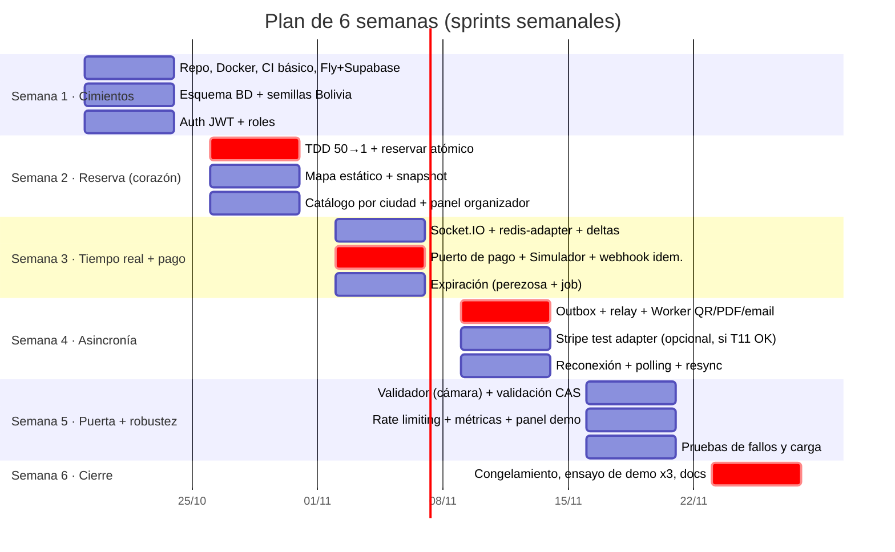

# 11 — Plan de 6 semanas

**Metodología:** Scrum adaptado, con **sprints de 1 semana**.
- **Lunes:** planificación (30 min). Se eligen las historias del backlog.
- **Diaria asíncrona** (mensaje en el grupo: ayer / hoy / bloqueos) + 15 min de llamada martes y jueves.
- **Viernes:** demo interna (cada uno muestra su slice funcionando **desplegado**) + retrospectiva (15 min).
- **TDD** en concurrencia e idempotencia. **Slices verticales:** cada persona entrega una funcionalidad completa (BD → API → UI), no "capas".

## 1. Equipo y responsabilidades

> Reemplazar "Integrante A/B/C" por nombres reales. Cada uno es **dueño** de un área, pero **todos** tocan BD, API y UI en sus slices.

| Persona | Área de responsabilidad | Slices principales |
|---|---|---|
| **Integrante A** | Núcleo de concurrencia y datos | Esquema de BD, reservas, expiración, tests de concurrencia, script de carrera |
| **Integrante B** | Frontend y tiempo real | Next.js, mapa de asientos, Socket.IO + reconexión/polling, panel de demo, validador con cámara |
| **Integrante C** | Pagos, Worker e infraestructura | Adaptadores de pago, webhook idempotente, outbox, Worker (QR/PDF/email), Docker, CI/CD, Fly/Supabase |

Rotación: en las semanas 4–5 cada uno **revisa** el código crítico de otro (A revisa pagos, C revisa reservas, B revisa expiración). Así los tres pueden explicar todo en la defensa.

## 2. Plan por semana

> Fechas de ejemplo (inicio el lunes 19/10/2026). Ajústenlas al calendario real de la materia.

### Semana 1 — Cimientos
| # | Tarea | Resp. | Entregable (criterio de aceptación) | Depende de | Días |
|---|---|---|---|---|---|
| **T1** | **Monorepo (tarea bloqueante, el lunes):** `apps/api`, `apps/worker`, `apps/web`, `packages/shared` + Docker local (Postgres 16, Redis 7, Mailpit) + `.env.example` + README "levantar en 5 min" | C | Otro integrante clona y levanta todo desde cero siguiendo el README | — | L |
| **T2** | CI: lint + typecheck + tests con Postgres y Redis como servicios, más protección de `main` | B | Un PR con un test en rojo no se puede mergear | T1 | M–Mi |
| **T3** | Cuentas y despliegue: **Supabase (`sa-east-1`) el lunes**. Después Fly (`gru`) y Vercel con sus **URL gratuitas** (`*.fly.dev`, `*.vercel.app`) y `GET /health` desplegado. Volver a verificar los free tiers y medir el RTT desde Cochabamba. **Dominio propio y Resend: opcionales** en esta semana | C | Proyecto de Supabase creado el lunes. `GET /health` responde desde `https://<app>.fly.dev` y el RTT queda anotado en la tabla de doc 10 | T1 (solo para Fly y Vercel) | L (Supabase) · Mi–V (Fly, Vercel) |
| **T4** | **Migración de `usuarios` primero** (`citext`, rol, `CHECK` del teléfono +591), lista el martes para desbloquear a B | A | `prisma migrate` crea `usuarios` en local y en CI | T1 | L–M |
| **T5** | Resto del esquema de doc 09, con SQL manual para índices parciales, `CHECK` y FK normales (incluye `simulador_pagos` y `pagos.creado_en`/`actualizado_en`) | A | Migración en limpio, sin errores, en local y en CI | T4 | M–J |
| **T6** | **Prueba de Prisma con el pooler de Supabase** en modo transacción (`pgbouncer=true`, `connection_limit`) + `prisma migrate deploy` con `DIRECT_URL` | A + C | Una consulta, una `$transaction` y un `$queryRaw` funcionan contra Supabase. Resultado anotado en el riesgo correspondiente (§3) | T3 (solo la cuenta de Supabase, lunes), T4 | M–Mi |
| **T7** | Semillas: 9 departamentos, ciudades de Cochabamba y un usuario por rol (ADMIN, ORGANIZADOR, VALIDADOR, COMPRADOR) | A | `npm run seed` se puede correr dos veces sin duplicar | T5 | J |
| **T8** | Tests de restricciones: 2 entradas válidas para un asiento, `CHECK` de estado/`orden_id`/`expires_at`, índice de RN-04, `UNIQUE(proveedor, evento_externo_id)`, FK `asientos.orden_id` | A | Cada INSERT inválido falla, en verde en CI | T2, T5 | J–V |
| **T9** | Auth completa: API de registro y login (argon2id, JWT HS256 de 60 min), `JwtGuard` y `RolesGuard` + **web de login** en Next.js (layout, login y registro en es-BO, cliente HTTP con token, ruta protegida) | B | A-01 (403) y A-04 (401) en verde. Login desplegado en `*.vercel.app` contra la API en `*.fly.dev` | T1, T4 (y T3 para el despliegue) | M–V |
| **T10** | **Contrato del simulador en `packages/shared`** (solo tipos y un documento, sin implementación): `ProveedorPago` (con `umbralReconciliacion`), `EventoPagoNormalizado`, formato de `Simulador-Firma` y cuerpo del webhook | C | PR revisado y aprobado por A | T1 | J–V |
| **T11** | **Probar si se puede abrir una cuenta de test de Stripe desde Bolivia** (registro, país, obtener `sk_test_`/`whsec_`) | C | Resultado anotado en doc 13 §1 (sí/no, con fecha). Decide si `StripeTestAdapter` sigue en la semana 4 | — | V |

**Ruta crítica:** T1 (lunes) → T4 (martes) → T9 (auth + web, hasta el viernes, con el despliegue de T3 al final). Si T1 se atrasa, A y B quedan bloqueados.
**En paralelo desde el lunes:** cuenta de Supabase (T3) → T6 (martes–miércoles, junto con T4). T2 (CI) tiene que estar lista antes de que T8 pueda bloquear merges.

### Semana 2 — Reserva atómica (el corazón)
| Entregable | Resp. | Criterio |
|---|---|---|
| **Test C-01 primero (rojo)** con una implementación ingenua y después el UPDATE condicional (verde). C-02, C-03, C-06 y C-07 | A | Los tests corren en CI |
| `POST /reservas` con `Idempotency-Key` y `DELETE /ordenes/:id` | A | — |
| Script `carrera.js` (50 → 1) | A | Corre contra local y contra Fly |
| Panel organizador: recinto, evento, zonas, grilla y publicar | C | Publicar genera las filas `asientos` |
| Listado por ciudad + detalle + mapa (snapshot REST, sin tiempo real aún) con selección y reserva | B | Comprar el flujo "hasta reservar" en el celular |

**Hito de la semana 2:** la demo de la carrera **ya funciona**. Si el proyecto se cayera aquí, el núcleo está demostrado.

### Semana 3 — Tiempo real + pago
| Entregable | Resp. | Criterio |
|---|---|---|
| `SeatsGateway` con salas por evento, `redis-adapter`, deltas con versión y coalescing de 250 ms | B | R-01 con 2 instancias locales |
| Puerto `ProveedorPago` + `SimuladorAdapter` (OK, rechazo, duplicar, demora, desorden) + webhook idempotente (**TDD: P-01 primero**) | C | P-01..P-07 en verde |
| Expiración perezosa en la reserva y en el snapshot + job `liberar-vencidas` | A | C-04, C-05, X-01 en verde |

### Semana 4 — Asincronía y tolerancia a fallos
| Entregable | Resp. | Criterio |
|---|---|---|
| Outbox + relay (SKIP LOCKED, `jobId`) + Worker: firma QR Ed25519, PDF (es-BO, hora La Paz) y email (Mailpit/Resend) con reintentos | C | W-01..W-06 en verde |
| **Opcional**, solo si la prueba T11 de la semana 1 confirmó que se puede abrir la cuenta de test desde Bolivia: `StripeTestAdapter` (Checkout en modo test) + `stripe listen` en local. La demo usa el **simulador como flujo principal** | A | Si se hace: pagar con 4242... emite la entrada. Si no: no afecta a la demo |
| Reconexión con backoff + jitter, fallback a polling, resync por versión, contador de reserva | B | R-02..R-04 |

### Semana 5 — Puerta y robustez
| Entregable | Resp. | Criterio |
|---|---|---|
| App del validador (cámara web) + `POST /validaciones` con CAS + asignación de validadores | B | A-03, A-05, A-06 |
| Rate limiting con Redis (+ degradado a memoria) + `/metrics` + panel `/admin/demo` + Bull Board | A | A-07, A-08. El panel muestra contadores |
| Pruebas de fallos en el entorno desplegado (caída del Worker y de Redis) + mediciones de latencia (completar la tabla del doc 10) | C | W-01..W-03 en Fly |

### Semana 6 — Cierre (sin funcionalidades nuevas)
| Entregable | Resp. | Criterio |
|---|---|---|
| **Congelamiento de código el lunes.** Solo correcciones de errores | Todos | — |
| 3 ensayos completos de la demo (uno con el plan C local) | Todos | < 12 min, sin sorpresas |
| Docs actualizados, ADR finales, resumen docente y diapositivas | Todos | El docente puede leer el doc 00 solo |

## 3. Riesgos

| Riesgo | Prob. | Impacto | Mitigación |
|---|---|---|---|
| Free tiers que cambian o Supabase pausado el día de la demo | Media | Alto | Verificar en la semana 1 y el día anterior. Plan C local ensayado |
| Fly pide tarjeta o el costo supera lo previsto | Media | Medio | Plan B Railway (US$5). Alertas de gasto. Apagar máquinas fuera de las semanas de demo |
| El pooler de Supabase en modo transacción + Prisma da problemas (prepared statements) | Baja (T6, 26/10/2026) | Medio | **Probado en T6: sin problemas.** Repetido contra el proyecto nuevo de Supabase en South America (São Paulo). Transaction pooler (`:6543`) con PostgreSQL 17.11, Prisma 7 + `@prisma/adapter-pg`, desde local. Las 5 pruebas OK (ver nota debajo). `PrismaService` **no se modificó**: no hubo problemas de compatibilidad. El adaptador `pg` usa sentencias preparadas sin nombre, compatibles con el modo transacción; `pgbouncer=true` era un parámetro del motor en Rust y aquí no aplica. Si algo falla más adelante: tamaño del pool con `max`, `transactionOptions` y CA de Supabase para SSL |
| La concurrencia "funciona en local" pero no en el despliegue | Baja | Alto | `carrera.js` contra Fly desde la semana 2 |
| Un integrante se enferma o abandona | Media | Alto | Slices verticales completos (nada queda a medias en capas). Revisión cruzada para que otro sepa continuar |
| La cuota de Resend (100/día) se agota en los ensayos | Media | Bajo | Mailpit en local y Resend solo en el entorno desplegado. Pocos emails reales |
| Sin dominio propio verificado, el proveedor de email (Resend) podría permitir enviar solo a la dirección de la cuenta, no a cualquier destinatario | Media | Medio | En desarrollo, Mailpit. Para la demo, enviar solo a correos del equipo o comprar un dominio barato y verificarlo antes de la semana 4. La entrada se ve igual en "Mis entradas" (doc 07 §5) |
| El mapa es lento en celulares de gama baja | Media | Medio | Canvas/SVG simple. Probar en el celular más viejo del equipo en la semana 3 |
| Stripe (opcional) no permite abrir la cuenta de test desde Bolivia, o sus webhooks no llegan en local | Media | Bajo | El simulador es el proveedor principal y la demo no depende de Stripe. Si se usa Stripe: prueba T11 en la semana 1 y `stripe listen` en local |
| Alcance demasiado grande | Alta | Alto | Plan de recorte (abajo) |

**Resultado de T6 (26/10/2026), repetido contra el proyecto nuevo de Supabase en South America (São Paulo), con un script desechable contra el Transaction pooler (puerto `6543`, PostgreSQL 17.11):**

| Prueba | Resultado |
|---|---|
| Lectura simple: `departamento.count()` | ✅ Devuelve `0` |
| `$transaction` interactiva (2 operaciones) | ✅ Las dos operaciones compartieron la misma transacción y la misma conexión (mismo PID) |
| `$transaction` por lotes (2 operaciones) | ✅ `departamentos: 0`, `ciudades: 0` |
| `$queryRaw` parametrizado | ✅ El parámetro volvió igual (`eco: 'T6'`) |
| `SET LOCAL` dentro de una `$transaction` | ✅ El valor estuvo disponible dentro de la transacción y desapareció después del `COMMIT` |
| Resultado final | ✅ `T6: todo OK` |

- **Los conteos en 0 son esperables:** todavía no hay datos sembrados en esas tablas (las semillas son T7). Las pruebas confirman que las tablas existen y responden a través del pooler, no que tengan datos.
- **Alcance de T6:** solo validó que las consultas y las transacciones se comportan bien a través del pooler. **No demuestra todavía que se eviten las compras duplicadas.** Eso lo prueban el test C-01 y la carrera de 50 → 1 (`carrera.js`, semana 2), primero en local y después contra Fly.

## 4. Plan de recorte (si falta tiempo)

Se recorta **de abajo hacia arriba**. Lo de arriba **no se negocia**.

| Prioridad | Funcionalidad | Si falta tiempo... |
|---|---|---|
| 🔒 1 | Reserva atómica + test 50 → 1 | **Nunca se recorta** |
| 🔒 2 | Webhook idempotente con el simulador | **Nunca** |
| 🔒 3 | Outbox + Worker + demo de caída | **Nunca** (es el requisito de tolerancia a fallos) |
| 🔒 4 | Mapa en tiempo real multi-instancia | **Nunca** |
| 5 | Expiración con job | La expiración perezosa basta para la correctitud. El job puede ser más simple |
| 6 | Validador con cámara | Fallback: pegar el texto del QR en un input |
| 7 | Stripe test (opcional) | Se recorta entero. El simulador ya es el proveedor principal, y el patrón Adapter se demuestra con el puerto `ProveedorPago` + `SimuladorAdapter` + el diseño de `QrBancarioAdapter` |
| 8 | Polling de respaldo | Solo la reconexión de Socket.IO |
| 9 | PDF | Email con el QR como imagen embebida, sin PDF |
| 10 | Rate limiting distribuido | Throttler en memoria |
| 11 | Panel organizador completo | Eventos cargados por script de semilla |
| 12 | Sala de espera virtual | Solo diseño (ya está en el doc 06) |

## 5. Pendientes (huecos menores 10–14)

- **10.** `01-vision-y-alcance.md` §7 cita `00-resumen-docente.md`, pero el archivo se llama `00-resumen.md`.
- **11.** En la raíz hay un `arquitectura.md` vacío y un `README.md` de dos líneas, mientras RNF-13 promete "levantar todo en 5 min siguiendo el README".
- **12.** Los plazos del job de expiración no coinciden: RNF-07 dice que limpia en ≤ 30 s y el test X-01 dice ≤ 15 s.
- **13.** Con el Worker caído, la entrada aparece en "Mis entradas" pero **sin QR** (solo el Worker tiene la clave privada Ed25519). Falta decirlo en W-01 y en el guion de la demo.
- **14.** El plan asigna `StripeTestAdapter` (semana 4) al Integrante A, mientras que la tabla de responsabilidades pone a C como dueño de pagos. Si es una rotación intencional, falta explicarlo.
